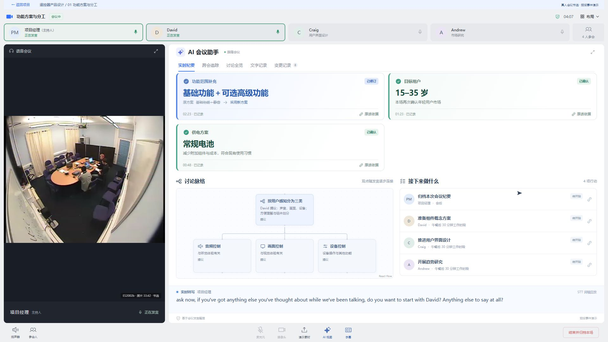
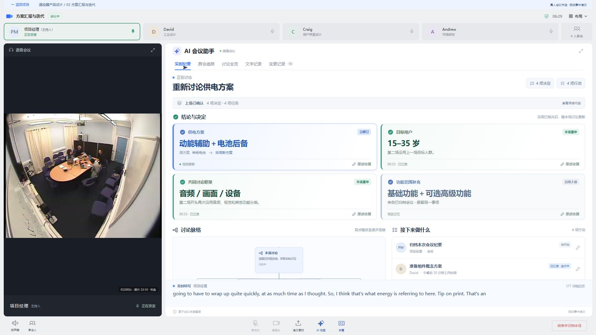
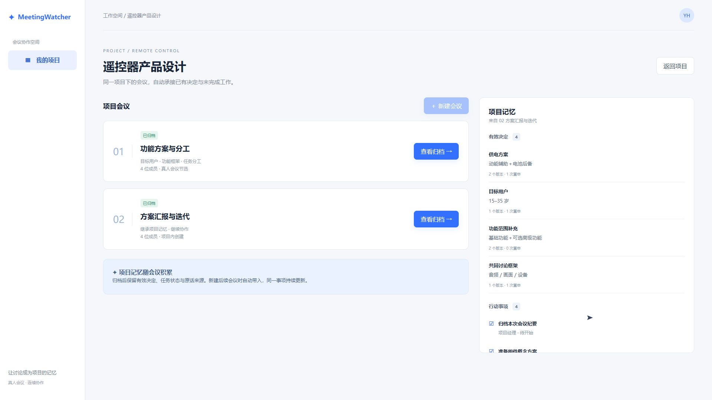
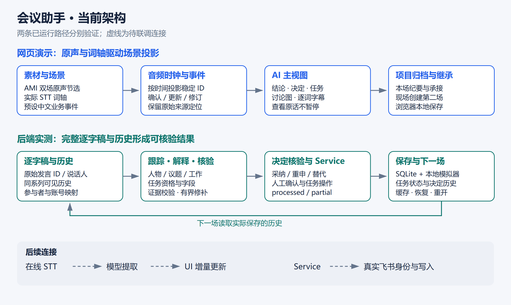

<div align="center">

# MeetingWatcher · 会议助手

把同一项目的连续会议串起来：会上看结论和分工，会后留下纪要，下场继续跟进任务和决定。

</div>



网页演示使用两场真人会议原声、实际 STT 逐词字幕和预设中文事件，展示从开会到跨会承接的使用过程。后端另以完整逐字稿运行提取、核验和历史更新，真实实验与前端展示分别记录。

## 功能

| 能力 | 用户看到什么 | 实现 |
| --- | --- | --- |
| 会中 AI 视图 | 结论卡、当前决定、任务负责人和进展 | AI 占主要画面，内容随会议出现；字幕固定可见 |
| 任务与原话 | 谁答应做什么、依据哪段发言 | 保留动作、对象、时间、条件和证据；原话查看不暂停会议 |
| 澄清与确认 | 普通候选、待采纳建议、待澄清意向 | 三种确认入口，补全动作和负责人后进入任务历史 |
| 决定版本 | 沿用、重申、修订前后及来源 | 后端以 reaffirms / supersedes 记录关系，区分有效清单和历史 |
| 会后归档 | 本场纪要、任务、决定及项目承接 | 项目保存会议归档，刷新后继续查看 |
| 下一场会议 | 项目内新建会议、邀请原班成员、接续上场内容 | 前端本地邀请模拟；后端同系列历史由 Service 读取 |
| 失败恢复 | 保留成功阶段，继续处理失败分支 | 阶段校验、接受缓存、有界恢复和 SQLite 持久化 |

<table><tr>
<td width="50%"><br/><sub>决定修订：保留原方案、当前方案和来源</sub></td>
<td width="50%"><br/><sub>项目归档：两场会议与跨会承接</sub></td>
</tr></table>

## 架构



后端处理顺序：

```text
完整逐字稿 + 同系列可见历史
→ 全文跟踪（人物、议题、工作线索）
→ 工作解释 → 独立核验 → 必要修补
→ 决定采纳、重申与替代核验
→ Service 保存结果、处理确认与任务操作
→ SQLite + 本地任务模拟器 → 下一场历史
```

前端使用音频时钟驱动 STT 词轴与预设场景事件，再投影到任务、决定和讨论图。在线 STT → 提取模型 → UI 尚未整链验收，真实飞书写入尚待联调。A2UI / AG-UI 是交互设计参考，当前使用自定义事件契约。

## 几处设计

- **工作与建议分开。** 已承诺工作、候选分工、待采纳建议和会议中的补充发言走不同入口，避免把“稍后我补充一句”变成制作任务。
- **任务内容与字段分开评测。** 工作被识别出来后，还要核对负责人、时间和条件；确认卡与 items 去重后计数。
- **先保存，再跨会更新。** 首场候选未确认时不会成为历史任务；后场汇报只有找到对应历史对象才能更新它。
- **决定有当前版本和历史。** 重申补充来源，替代改变有效值；读者仍能追到旧决定。
- **恢复以阶段为单位。** 失败时保留原件和已接受输出，通过现有 Service 恢复。

## 评测

| 范围 | 结果 | 解释 |
| --- | --- | --- |
| 115 场景历史回归 | 任务 P 94.7%、R 98.6%；完整任务 P 92.1%、R 95.9% | 研发回归，含自然片段和构造对照；自然核心单列为 81.0% / 94.4% |
| v19 ES2002a/b 完整重测 | 任务 7/8、7/7；决定 15/15、10/11 | 分别为精确率与参考召回，包含首场失败恢复 |
| v19 两场新参会组 | 任务内容 7/7、7/7；决定 23/23、18/20 | 同 AMI 设计场景；含负责人严格任务口径为 6/7、5/7 |
| 真人 b/c 连续会议 | 4 项决定重申；供电变更只进事实 | 完整逐字稿共 1,976 段；候选未确认影响历史任务关联 |
| 已确认任务定位对照 | 3/3 关联正确，0 重复新建 | 次场 71 段；Andrew 完成状态需复核 |

这些组别输入、配置和计数对象不同，不合成一个总分。标注与原文复核由助手完成；样例已用于研发，没有多人独立金标。逐项证据见[评测索引](docs/EVALUATION.md)，调优过程见[任务与决策提取调优](docs/TUNING.md)。

## 运行

前端需要 Node.js 22+；后端核心需要 Python 3.11+，只用标准库。

```powershell
git clone https://github.com/yhnapoleon/MeetingWatecher.git
Set-Location MeetingWatecher/demo
npm ci
npm run dev -- --host 127.0.0.1 --port 4173 --strictPort
```

打开 http://127.0.0.1:4173 ，进入项目和第一场会议。加入现场自动开始，普通模式无播放控件；第一场归档后创建第二场，用 Alt+I 邀请原班成员。默认播放不需要模型密钥或 STT 服务。素材是 13:02 的顺序节选，完整操作主片为 15:11，留在本地交付目录。

在仓库根目录核对已发布评测，不调用模型：

```powershell
$env:PYTHONUTF8='1'
python scripts/verify_release_evidence.py
```

对新输入使用当前 v19 方案：

```powershell
Copy-Item .env.example .env
# 填写自己的模型凭据；预检不发请求。
python scripts/run_current.py --input examples/m1.json --out runs/my-meeting
# 显式调用模型，使用全新输出目录。
python scripts/run_current.py --input examples/m1.json --out runs/my-meeting --live
```

这个入口显式使用 context-v5 v19 + DecisionReview v2；普通 CLI 默认仍为 split-v3。实时 STT、核心离线测试、已有数据库查询及视频重录见[配置说明](docs/CONFIG.md)。

## 数据与目录

AMI 真人角色扮演会议及派生媒体按 CC BY 4.0 使用；原始时间、剪辑范围、字幕与人工事件来源见[媒体署名](demo/public/MEDIA_CREDITS.md)。VCSum 及其他文本来源见[数据说明](data/mvp-v1/README.md)。

```text
meeting_eval/   提取、核验、状态归并、Service、SQLite 与任务模拟器
prompts/        各代提示与输出契约
demo/           React 前端、默认媒体、场景、STT 和录制工具
config/         当前 v19 推理配置
examples/       中文连续会议示例及预期
data/           选定文本、标签、来源与许可
experiments/    各阶段实验、评分与恢复入口
tests/          离线测试与必要夹具
scripts/        通用脚本、便携推理入口与公开证据检查
runs/           公开保留两场新参会组的选定文本证据
docs/           复盘、调优、配置、架构、截图与历史研究记录
```

历史数据库、原始模型响应、原始语料包、录制帧和主片保留在本地。历史报告中的部分 runs 链接因此只在原工作区可用；公开复核和完整历史重放的边界见[同步与复现范围](docs/GitHub同步与复现范围.md)。

## 文档

- [项目复盘](docs/RETRO.md)：阶段演进、功能实现、评测与经验。
- [调优记录](docs/TUNING.md)：具体错误、机制、改动及同口径结果。
- [配置说明](docs/CONFIG.md)：前端、后端、STT、结果读取与录制。
- [当前技术设计](docs/design.md)：两条数据路径、对象与状态边界。
- [固定用例与评测证据](docs/EVALUATION.md)：用例索引与可复算范围。
- [演示视频验收](docs/项目会议视频验收.md)：连续播放、声音及成片验证。
