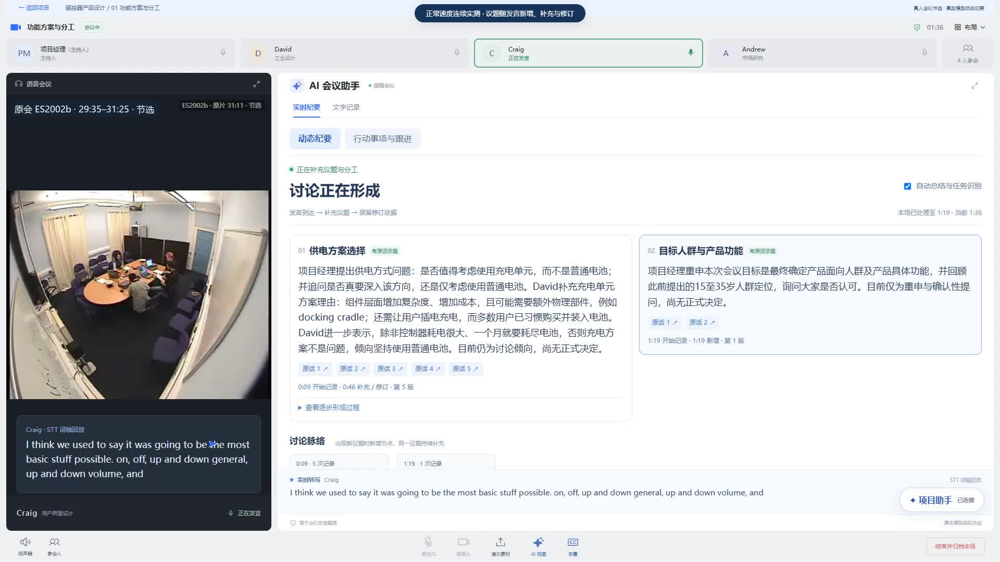
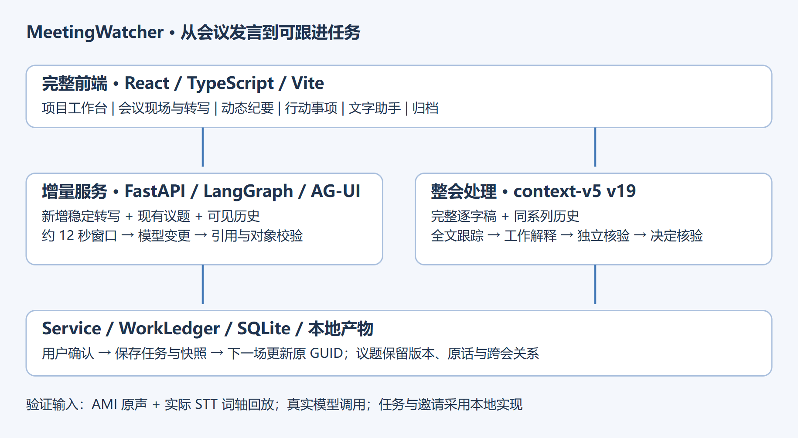
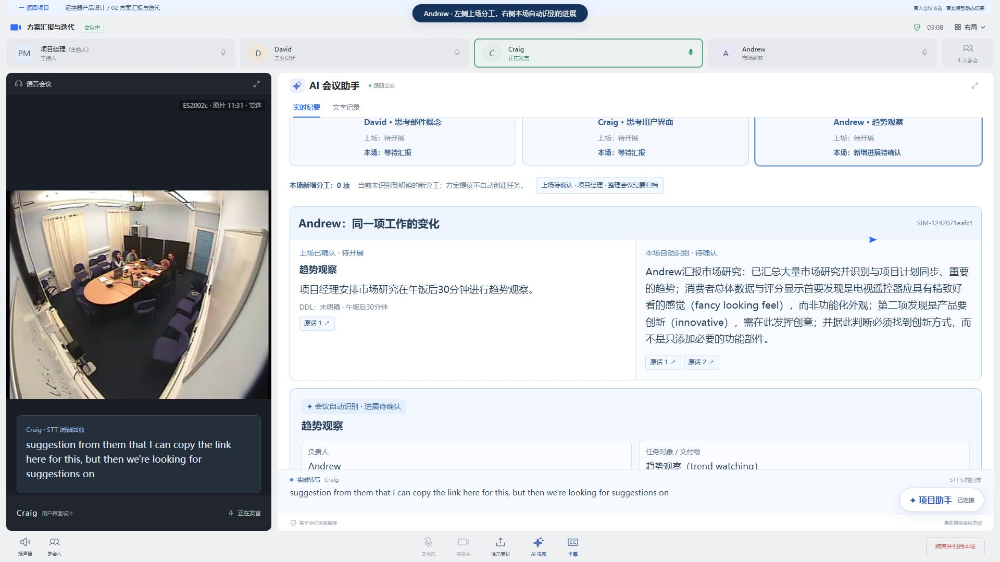
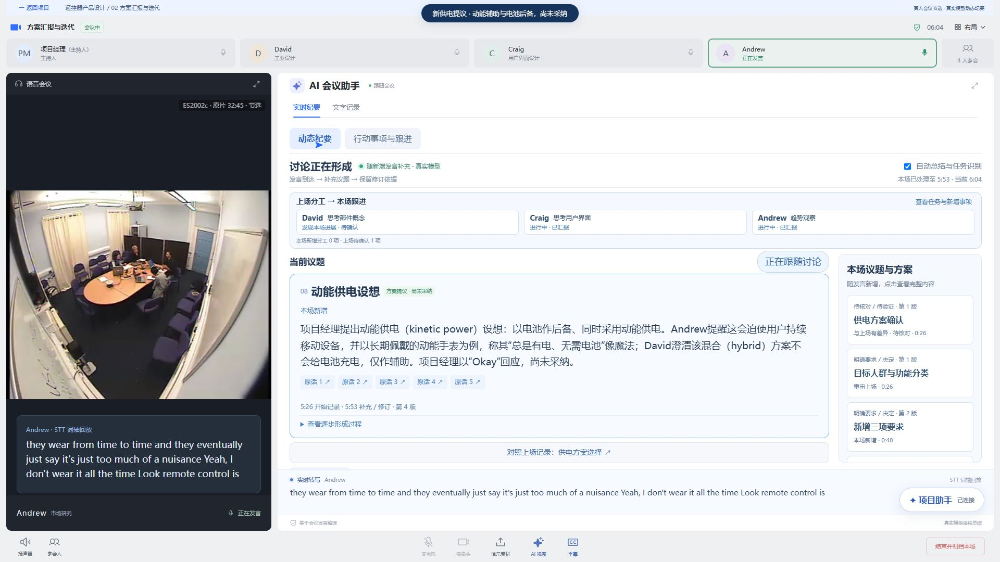
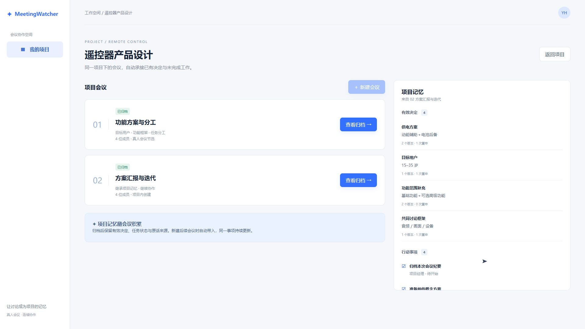

# 会议助手项目复盘

## 项目概述

会议助手围绕同一项目的连续会议组织信息：开会前承接上场留下的任务和决定，会上查看逐词转写、讨论结论及分工，会后归档纪要，下场会议继续更新原任务和决策版本。用户可以回到原话核对依据，也可以先澄清含糊的意向，再确认成任务。

当前应用由项目工作台、会议现场、动态纪要、行动事项、项目助手和归档组成。React 前端通过 AG-UI 与 Python 服务连接，随新增发言调用模型更新议题和分工；用户核对原话并确认后，任务进入持久化账本，下一场继续更新同一对象。完整逐字稿还可通过 context-v5 提取链路进行独立评测。

| 项目 | 当前实现 |
| --- | --- |
| 提取方案 | 可选 context-v5 v19，配合 DecisionReview v2；默认命令行策略仍为 split-v3 |
| 模型 | deepseek-flash；全文跟踪和任务核验 high，工作解释 low / 32768 |
| 后端 | Python；整会提取使用 Service，实时助手使用 FastAPI、LangGraph、AG-UI；SQLite、本地任务模拟器 |
| 前端 | React、TypeScript、Vite；项目、会议、实时 AI 视图、归档与跨会承接 |
| 数据 | AMI 英文自然对话、VCSum 中文会议片段、构造边界用例；AMI 演示素材为真人角色扮演设计会议 |
| 当前演示 | ES2002b → ES2002c，782 秒节选素材；15:13、1080p；第二场从 05:32 开始 |
| 文档 | 本报告、调优记录、配置说明、架构图、固定用例与证据索引 |

## 架构与数据流

应用以会议音频时钟同步字幕和证据范围。STT 词轴逐步释放已经发生的发言，增量处理器约以 12 秒新增稳定转写为一个窗口，连同已有议题、已确认任务和可见的上场归档送入模型。模型返回议题变更和工作变更，程序检查引用、对象 ID、跨会关系及时间范围后保存。处理较慢时按窗口补齐积压，界面显示实际总结到的时间。

LiveSummary 在当前议题阅读区更新同一张卡，保留稳定 ID、版次与原话；独立目录只加入已经生成的议题。WorkBoard 展示自动产生的分工候选、任务字段和确认入口，文字整理也进入同一账本。用户确认通过 Service 写入本地任务模拟器，后续汇报按任务 GUID 形成更新候选；确认前后及两场证据均可回看。

项目助手通过 AG-UI 展示工具执行状态和回答，LangGraph checkpoint 保存运行状态。它按当前项目和会议游标检索证据，支持文字追问、补课、比较表、验证清单、材料修改与下载。会后归档保留当时可见的内容，回看首场不会直接套用第二场状态。

完整逐字稿处理由 Service 读取同系列历史，依次进行全文跟踪、工作解释、独立核验和必要修补，决定另经采纳、重申与替代核验。这条整会处理链用于长文本评测，与会中增量应用分别报告结果。当前产品验证使用 AMI 原声与实际 STT 词轴回放；在线 ASR 和真实飞书身份、任务写入仍需联调。成员邀请与任务写入采用本地实现。

## 阶段与版本

| 阶段 | 版本或产物 | 关键设计与结果 |
| --- | --- | --- |
| 数据与基线 | mvp-v1、直接提取与 split 系列 | 固定原文、说话人、事件标注与证据 ID；以任务和决定为独立对象建立评分、保存及跨会回放 |
| 上下文理解 | context-v1 至 v5 | 从直接输出行动项发展为全文跟踪、工作解释、独立核验和状态归并，保留条件、负责人及时间含义 |
| 长会议处理 | context-v5 v16–v17 | 修复进度汇报误入新建卡及证据 ID 契约；完整会议由 partial 恢复到 processed，保存已接受阶段 |
| 任务与决定边界 | context-v5 v18–v19、DecisionReview v2 | 区分会议发言与待澄清意向；加入决定采纳、最终状态和跨会重申关系；完成整会重测及新参会组复核 |
| 连续会议验证 | AMI b/c 完整实测及确认对照 | 同库顺序处理两场，发现候选分工没有进入历史任务、供电决定漏更新及跨会范围误关联 |
| 项目工作台 | 项目、会议与归档 | 会中查看、会后归档、现场新建第二场及成员邀请；原话与项目状态持续可查 |
| 实时助手 | LangGraph + AG-UI | 按当前证据追问、补课、委派材料、修改和下载，保存工具过程及产物版本 |
| 增量纪要与任务 | 12 秒窗口、稳定议题 ID、WorkLedger | 纪要随发言补充；自动提取和文字整理汇入同一候选；第二场更新原任务 |
| 双场交互验证 | 2026-11-23 完整应用 | 完整阅读区、议题目录、上场与本场对照；真实录制 15:13，三项任务贯穿双场 |

## 功能、实现与验证

| 用户能力 | 实现机制 | 已有验证 |
| --- | --- | --- |
| 知道谁答应做什么 | 工作记录保留动作、对象、负责人、承诺状态、时间及原文；任务项与确认卡按记录去重 | 115 场景历史回归及四场 v19 完整会议任务复核 |
| 含糊时先确认 | 普通候选、待采纳建议、待澄清意向分别进入 add_task、adopt_and_add_task、clarify_and_add_task | 澄清后保存、重复确认及权限相关定向测试 |
| 汇报继续更新旧任务 | Service 读取历史任务，模型返回 target_guid，状态事件由程序执行 | 确认后的 71 段对照中，3/3 汇报关联正确任务，新增任务为 0 |
| 查当前决定和旧版本 | reaffirms 保留重申来源，supersedes 表达替代；有效清单与历史分别查询 | 中文两场对照保留 2 项有效决定、4 条历史；真人 b/c 保存 4 项重申 |
| 失败后继续处理 | 阶段校验、接受缓存、有界重试及 Service.retry_extraction；保存首轮失败记录 | ES2002a 重测增加 1 次核验完成；b/c 次场在副本中增加 1 次核验完成 |
| 在网页跟随会议 | 新增转写→模型增量变更→稳定议题与工作账本；原话弹层不暂停会议 | 第二场 39 次增量处理、35 个可见状态；33 项 Copilot 测试及前端检查通过 |
| 会后留下项目记录 | 本场归档、项目承接、下一场创建与成员邀请 | 双场归档、刷新后持久化、第二场从空白生成内容的浏览器验收 |

早期 71 段确认定位对照中 Andrew 的完成状态仍需复核。当前双场应用将三位成员的阶段汇报均记录为进行中；这是另一组输入与运行，不能覆盖早期实验的状态错误。

## 评测与结果

任务识别采用 Precision（正确任务 / 预测任务）和 Recall（命中参考 / 必需参考）；负责人、时间和条件另看完整任务指标。决定的精确率依据输出主张逐条核对，召回依据固定参考。处理完成状态衡量链路是否交付结果，与语义正确率分开。

| 评测范围 | 任务识别 P / R | 决定 P / 参考 R | 说明 |
| --- | --- | --- | --- |
| 115 场景历史回归 | 72/76，94.7% / 72/73，98.6% | 分项见历史报告 | 117 个处理单元；完整任务 P/R 为 92.1%/95.9% |
| 其中自然核心 30 场景 | 17/21，81.0% / 17/18，94.4% | — | 总分不能替代自然语料表现 |
| v19 ES2002a/b 整会重测 | 7/8，87.5% / 7/7，100% | 15/15，100% / 10/11，90.9% | 两场开发会议；包含第一场失败阶段恢复后的结果 |
| v19 IS1000a/TS3003b | 内容 7/7 / 7/7 | 23/23 / 18/20 | 同 AMI 场景的新参会组；两项决定在事实栏保留 |

新参会组两场若计入负责人绑定风险，整条任务记录的精确率为 6/7、完整参考召回为 5/7。IS1000a 将一般设计和技术设计合并并全绑定 C；因此内容命中并不能直接作为自动分派质量。TS3003b 未决栏目还存在重复及与已决方向冲突的记录。

115 场景是已有研发回归，包含构造对照和同源片段；任务级口径在预测后由助手依据原文、冻结标签和业务契约补充审计，不是独立人工盲测。历史整例通过率 98/115 衡量全部业务输出，不能称为任务准确率。完整会议与历史片段的配置、输入范围和判分对象不同，分别保留原结果。

真人跨会使用完整 b/c 逐字稿共 1,976 段，同一个新 SQLite 顺序处理。首轮次场任务核验两次截断；恢复后识别三位成员的汇报，但首场分工是未确认候选，没有对应历史任务可关联。经正常确认 API 建立历史后，另以次场 71 段原文做定位对照，三项关联成功。这个对照解释了历史入口的影响，不作为另一轮完整会议成绩。

证据和复核入口统一列于[固定用例与评测证据索引](EVALUATION.md)，各组分母和配置以对应原报告为准。

## 代表性调优

“I'll add it later, I guess the presentation.” 曾被理解成要制作或补充演示材料。v19 核验结合前后发言，将其归为会议中的补充发言，最终不形成任务或澄清卡。与此同时，“if that's possible we might consider getting into it”仍被当作条件工作，说明“有条件措辞”与“作出条件承诺”仍需要区别。

另一类问题发生在程序归并层：GN29 两条进度记录已有 progress 状态，却因带时间字段被报告入口拒绝，再落入可新建任务的确认卡。修改报告入口保留 time，并要求新建事件有 future_work 依据后，固定输出回放的额外预测从 7 项降到 5 项。这一变化可以归因到归并逻辑；后续 GN33 出现一个任务入口漏项，仍保留为回退证据。

长会议的协议修复则来自具体边界冲突：输入用证据对象描述片段，输出要求 ID 字符串，提示混用了两种格式，解释节点又缺少封闭 schema。修复契约和反馈后，ES2002a 恢复成功；真实调用首轮解释就通过，补丁分支仅有离线验证。具体原话、机制、条件和前后结果见[调优记录](TUNING.md)。

## 完整应用的双场验证

第一场从空白纪要开始，供电问题、反对理由和当前倾向逐步写入同一议题。分工发言到达后，行动事项自动出现，列出负责人、任务对象、工作内容、DDL、原话时间表达及依据。David、Craig、Andrew 三项任务经用户确认进入账本；文字整理复用候选，不再创建另一组任务。

第二场从本场新增发言开始形成议题，依次展示目标人群与功能要求、三人的研究汇报、部件约束和动能供电提议。任务页并排查看上场分工和本场进展，三次确认仍指向原 GUID，共保留六次确认快照，重复新建为零。所选片段没有明确新分工，因此新增任务显示为 0；忽略图文电视、仅控制电视、公司颜色及标语等新要求单独呈现，动能方案保留为未采纳提议。

本次第二场共有 39 次增量处理、8 张议题卡，35 个可见更新状态通过阅读范围检查。自动状态条和议题目录分别布局，正文保持在视口中；查看旧议题可以固定选择，返回“跟随最新”继续阅读。模型输出、确认记录与画面状态共同验证“生成、查看、确认、更新”这条路径，不计入历史任务识别率。

完整视频为 15:13、1920×1080、30 fps，第二场从 05:32 开始。四段快放均显示“▶▶ 快进中”，关键生成与任务确认保留正常速度。全片解码通过，十个正常速度声音定位抽样偏移均为 0 ms；最终成片的新增要求、三人任务对照和新提议画面已逐项查看。记录见[双场应用验证](第二场AI视图修订_实现与验证.md)和[核查数据](evidence/second-view-v5-2026-11-23.json)。

## 工程化与复现

整会提取核心使用 Python 标准库；实时服务依赖与锁定版本分别保存在 meeting_copilot/requirements.txt 和 requirements-lock.txt。前端使用 React、TypeScript、Vite，依赖由 package-lock.json 固定。SQLite 保存工作账本、助手作业和检查点，生成材料以文件和版本记录保存。

项目材料包括复盘报告、调优记录、配置说明三份 PDF，以及源码包、测试用例、架构图和演示视频。源码包保留原项目结构，并收录数据、标注及选定评测证据；无需模型即可核对冻结证据和运行离线检查，配置自己的模型凭据后可启动完整应用或对新逐字稿推理。历史 115 场景的评分原件及索引保留；完整模型请求和历史数据库属于原工作区材料。具体范围见[配置说明](CONFIG.md)与[评测索引](EVALUATION.md)。

## 经验与后续

任务质量要沿着“识别 → 核验 → 归并 → 确认 → 历史 → 更新”检查。只有文本中出现了工作还不够：卡片可能未保留工作范围，候选可能尚未成为历史任务，正确关联也可能附带错误状态。把这些对象分别保存和计分，才能知道该修哪一步。

后续优先处理三类已经影响实际结果的问题：任务资格与条件承诺、最终裁决遗漏已发现的决定、跨会相似动作缺少会议和交付物范围。GN25 条件支付在补充覆盖提示及 low 核验后仍为 2/3；供电新方案虽进事实却未更新有效决定；本场纪要曾误关联上场纪要。这些结果支持继续研究独立判断和对象范围，不支持按单句关键词补规则。

当前增量结果已连接到纪要、任务与助手界面。后续集成重点是在线转写的修订事件、真实飞书身份映射与任务写入，并在更多会议主题上测量端到端延迟、任务完成判断和新旧对象关联质量。

