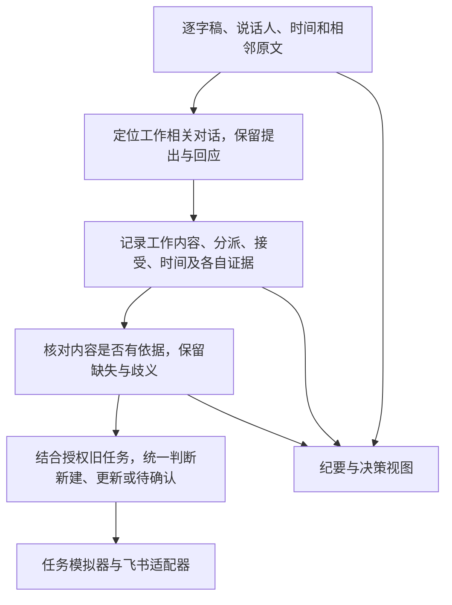

# 行动项持续错漏的原因与架构改进

日期：2026-11-14。对象：当前离线 MVP 的 `split-v3`，重点是行动项抽取及其评测。

后续实施安排见 [行动项语义评测与证据处理流程方案](superpowers/plans/2026-11-14-action-evidence-pipeline.md)，包含接口、任务顺序、对照实验与默认切换条件。

**现在的主要问题，是模型没有稳定地把一段对话还原成“谁提出什么、谁接受、承诺到什么程度”，而系统又把引用存在当成了内容有依据。评分也漏检了任务描述，因此部分错误能一路通过校验，并表现为分数提高。** 前轮将不同输出拆开是必要的，但仅按“任务、事实、决定”分工，还不足以解决这些问题。

本轮沿输入、原始响应、校验和评分追查，并完成了 52 次真实模型诊断调用。新增内容限于实验提示、运行器、原始记录和本文；默认模型配置、生产提示、业务状态与参考答案保持原版本。论文和开源实现用于判断下一步设计，接入效果与已经跑出的实验结果分别说明。

## 1. 从一个会被评分漏掉的错误说起

C20 的原话先明确说剪辑视频并交给大家确认，之后只补了一句“然后还有这个文稿可以吧”。当前参考答案将视频列为团队承诺；文稿的具体处理动作不明确。

普通抽取输出两项：剪辑视频，以及“整理文稿并发送给大家确认”。事件结构实验把它们合成一项：“……剪辑视频并给大家确认，同时处理文稿。”后者仍把不确定的文稿动作写成了承诺，但现有评分认为多余行动项减少了，给出更高的分数。

这是两层共同失效：

- 校验器只确认 `evidence_ids` 指向输入中的句子，不判断句子是否支持“整理、发送、处理文稿”这些动作。即便再要求逐字引用，引用也只能证明原话存在，不能证明解释正确。
- 评分器按 `case_id + action_anchor` 匹配，检查负责人、操作和时间，却没有检查 `description` 的语义。把错误附加内容并进一条正确任务，可以绕过“多报一条”的惩罚。

为确认不是个别样例，我在内存中把此前完整开发集预测的所有任务描述替换成“采购二百台服务器并立即付款”，保留其他字段。**整个评分报告完全不变，行动项 F1 仍为 75.0%。** 原预测和参考答案未修改。[反例记录](../runs/2026-11-14-action-architecture/metric-blindspot.json)；[评分实现](../scripts/score_mvp_actions.py)；[校验实现](../meeting_eval/extract.py)。

因此，现阶段不能把行动项 F1 上升直接解释为用户收到的任务更准确。继续围绕这个分数调提示词，会奖励一部分错误做法。

## 2. 错误究竟发生在哪一层

### 2.1 当前剩余漏项，不能继续归结为其他任务抢走了注意力

前轮已经核对过：21 个开发片段中，单独运行行动项与完整 `split-v3` 的行动项分支，请求内容一致。完整流程中的事实、决定是独立请求，程序也不会用它们覆盖行动项。[请求一致性记录](../runs/2026-11-14-repair-validation/checks.json)

C09 的原始模型响应直接是空列表，结束原因是 `stop`，仅生成 13 个 token。任务在进入后续校验前就没被提取出来。当前证据不支持把这次漏项归因于响应被截断或汇总时丢失。这个结论针对修复后的分支；它不否定此前将多个目标塞进同一请求会增加干扰。

“只抽行动项”内部仍包含多个判断：找出工作内容、连接不同人的问答、识别负责人、判断是否承接、区分工作时段与截止时间，最后决定 `create` 或 `candidate`。现在这些判断压在一次生成中，某个判断不确定，就可能整项消失；某个判断过于积极，就可能补出不存在的承诺。

### 2.2 对话被截断，和模型没读懂对话，是两个相互影响的问题

C03 开头是零散的“用户界面，技术功能……”。它前面的 C02 才建立了分工语境：项目经理先说明下一场会的安排，再对工业设计师说这段时间要做什么。**这是数据集预先切成片段造成的边界，当前程序没有在读取 C03 时额外删除句子。**

我把同场会议的 C02 原文接回 C03 前面，保留 C03 原文、角色和其他请求参数；只检查 C03 的两项分工是否被找回。每个条件重复两次：

| 输入及模型模式 | 界面设计分工 | 营销分工 |
| --- | --- | --- |
| 原 C03，不开推理 | 0/2 | 0/2 |
| 接回前文，不开推理 | 0/2 | 2/2 |
| 原 C03，开启推理 | 0/2 | 2/2 |
| 接回前文，开启推理 | 2/2 | 2/2 |

这支持“分工前文有用，而且需要模型把前后关系串起来”的判断。它不是大样本因果估计；开启推理后仍多报了一项发邮件任务。扩展输入自然包含 C02 的任务，因此本实验不把那些任务算作 C03 误报，也不和原片段直接比较 F1。[输入、请求与结果](../runs/2026-11-14-action-architecture/context-probe/)

下一步处理整场会议时，切分单位应覆盖“提出—回应—补充/否定”的对话过程。仅按固定字数切块、先压缩成摘要再抽任务，都可能丢掉决定任务含义的部分。

### 2.3 找到证据，不等于判断对了承诺关系

C09 的营销人员问下次会议前要看什么，项目经理回答说明书，营销人员回应 Okay。事件实验已经找到了工作对象、负责人和时间，却把整段判为建议，`acceptance_evidence` 为空；程序随后按实验策略过滤建议，最终仍是空列表。故障已经从“什么也没输出”定位到“对话关系分类错了”。

C26 的“我们可以在会后……细化一下这个场景”，则在本轮所有方案中都进入了候选任务；参考答案将它视为无人承接的建议。C02 还有另一种情况：事件实验正确地把结构化截止时间留空，却在任务描述中继续写“下次会议前完成”。同一条输出的字段与自然语言能相互矛盾。

现有 `candidate` 也混合了不同原因：已承诺但没有个人负责人、未接受的指派、条件承诺、仅仅提议。后续无法单凭这个状态判断缺的是身份、接受证据，还是根本没有形成任务。

这些是同一类结构缺口：**内容、承接状态和执行条件没有独立记录，也没有分别核验。** 单纯增加字段仍不够；本轮事件实验依然由同一个非推理模型一次填完所有事件属性，尚未真正把这些判断分成可单独纠错的步骤。

### 2.4 参考答案也要分清“有任务”和“可以直接执行”

项目初标参考了 AMI 的行动项摘要，并额外判断承接和创建条件。我回查了原始 AMI 对话行为标注：C09 的 Okay 属于 Backchannel；C03 的 Okay、C02 的 Yep 属于 Assess。这些标签描述的是说话行为，与本项目的任务接受标准不同，不能据此直接宣布项目标错。[回查记录](../runs/2026-11-14-action-architecture/original-dialogue-acts.json)

但它暴露出需要复核的边界：来源摘要认为有后续工作，不等于输入片段足以证明某个人明确接受了任务。C09 的“查看说明书”也比参考答案的“研究使用者对说明书的看法”更笼统。下一版标注应分别记录工作内容、分派、接受和不确定性，并保证每项要求都能由模型实际看到的上下文判断。本轮保留原初标，以免根据模型表现改变答案。

## 3. 本轮对照：什么有改善，什么没有

选择已见开发片段 C02、C03、C09、C20、C21、C26，其中有 6 条参考行动项。四个方案各跑两轮，共 48 次调用；加上上面的 4 次补前文实验，共 52 次。使用同一 `deepseek-flash`，请求上限统一为 8,192 token；保存模型返回版本、请求、响应、提示和答案快照。主实验以固定随机顺序提交、最多四个请求并发，耗时统计为每次请求的墙钟时间。参考答案只供评分，未传给模型。

推理模式使用 `thinking=enabled`、`reasoning_effort=high`，请求中传入温度 1，并另加不开推理、温度 1 的对照。实施时再次核查官方说明，推理模式会忽略 temperature，而非固定采用该请求值；因此这个对照只能观察非推理模式的温度变化，不能作为有效采样温度完全一致的控制实验。原请求与结果不变。[DeepSeek 官方说明](https://api-docs.deepseek.com/guides/thinking_mode/)

| 方案 | 两轮行动项 F1 | 平均 F1 | 每轮六例平均总 token | 平均单次耗时 |
| --- | --- | --- | --- | --- |
| 原行动项提示，不开推理，温度 0 | 54.5%、54.5% | 54.5% | 7,552 | 2.27 秒 |
| 同提示，不开推理，温度 1 | 54.5%、61.5% | 58.0% | 7,651 | 2.10 秒 |
| 同提示，开启推理 | 76.9%、71.4% | 74.2% | 15,563 | 9.65 秒 |
| 先输出证据和事件，再用代码转任务；不开推理 | 72.7%、72.7% | 72.7% | 9,129 | 3.14 秒 |

**这里的 F1 仍是有上述缺口的旧指标，且仅覆盖六个已见难例，不能当成完整开发集或泛化成绩。** 事件方案同时改了提示、输出结构和转换规则，不能把差值单独归功于某一项。逐条复核后的结论是：

- 推理模式两次都找回 C09 的任务和对应负责人、时间；温度 1 对照两次都漏。但任务描述仍比参考答案笼统。增加推理预算有价值，尚不能替代内容核验。
- 事件方案两次都找回 C03 的营销分工，且没有那条邮件误报；界面分工和 C09 仍漏。它提供了更可检查的中间结果，但没有解决关系理解。
- C20 的文稿推断、C26 的建议误报持续存在。C21 的真实团队承诺则在四个方案中都保留，说明不能简单把所有“我们……”或不具名事项一起过滤。
- 推理方案总 token 约为温度 0 对照的 2.06 倍，单次耗时约 4.25 倍。这是本次调用的观察，不是价格或生产延迟保证。后续应测不同推理预算，或在完整基线建立后测选择性升级。

52 次调用均完整返回并通过结构检查，8 份分轮评分可从保存的结果重算一致。这说明失败主要仍在语义判断；“请求成功、JSON 合法”不能作为任务质量成功的标准。现有 39 项自动测试也重新通过；它们验证业务链路和既有校验，不代表模型抽取质量通过。[汇总](../runs/2026-11-14-action-architecture/summary.json)；[离线复核](../runs/2026-11-14-action-architecture/audit.json)

## 4. 可借用的论文和开源机制

### 对话式行动项抽取：先还原一段分工过程

Purver 等人的 SIGDIAL 2007 论文将行动项识别拆成：先定位提出、讨论和承诺任务的子对话，再抽任务及时间。其表示区分任务描述、时间、负责人分派、接受/承诺四类信号。这与 C03、C09 的失败直接相关：动作不一定在同一句中说全，也不一定包含明确祈使句。[论文与 PDF](https://aclanthology.org/2007.sigdial-1.4/)

可借用的是对话单元和角色设计。论文采用的历史分类模型不能直接当作今天可用的中文会议抽取器，其实验分数也不能与本项目横比。

### LangExtract：复用原文定位与证据展示

[Google LangExtract](https://github.com/google/langextract) 提供原文跨度定位、分块、多轮抽取与可视化。已检查 README、OpenAI 兼容提供器、输出结构文档及 resolver；代码版本固定为 `0e441bf77ddc3119dd0aa413322959234dd84ee5`，Apache-2.0。

适合复用的是“把每个字段对应到哪段原话、显示给人核查”。接入时应保留字符位置与匹配状态，区分精确匹配、模糊匹配和未匹配；解析失败也应继续显式暴露。当前引用 ID 可以保留，在其下补字段级跨度。[定位实现](https://github.com/google/langextract/blob/0e441bf77ddc3119dd0aa413322959234dd84ee5/langextract/resolver.py)

它不能替我们判断“提及文稿”是否等于“承诺整理文稿”。仓库也说明推断属性的正确性仍依赖模型与任务。兼容接口支持自定义地址，但本项目的 DeepSeek 接入、结构约束和中文对齐仍需实际验证；本轮未安装或接入此库。

### MiniCheck：单独检查每个任务陈述是否有依据

[MiniCheck 论文](https://aclanthology.org/2024.emnlp-main.499/)和[实现](https://github.com/Liyan06/MiniCheck)接收文档及待核对陈述，预测文档是否支持该陈述。它适合尝试拦截“视频有依据，因此连带文稿动作也被接受”这类错误：把视频剪辑、文稿整理、负责人、截止时间分别作为待核对内容。

核验器只能查已生成的内容，不能自动发现根本没生成的任务，所以仍需要单独检查漏项。其中文会议、短应答承接与隐含分工效果尚未在本项目验证。代码是 Apache-2.0，具体模型权重另有许可条件，README 特别说明 Bespoke 7B 的商用授权；选型时要分别核对代码和权重。适合作为隔离实验中的核验基线，当前不直接加入运行依赖。

### QMSum、ExplainMeetSum：借用检索与标注方法

[QMSum](https://github.com/Yale-LILY/QMSum)将相关片段定位与查询式会议摘要分开，并提供相关跨度；[ExplainMeetSum](https://aclanthology.org/2023.acl-long.731/)提供支持摘要的证据标注。它们对整场会议中的上下文选择和“结论必须有可核查依据”的评测设计有用。

二者任务主要是摘要，不直接提供“谁已承接、能否创建平台任务”的完整答案。借入相关 AMI 数据时还必须按会议或系列去重，不能把同一场会议的其他版本算作新保留集。

### DSPy / GEPA：等评价标准可信后，再自动改提示

[GEPA 论文](https://arxiv.org/abs/2507.19457)及[DSPy 的 GEPA 文档](https://github.com/stanfordnlp/dspy/blob/main/docs/docs/api/optimizers/GEPA/overview.md)使用执行轨迹、评分和文字反馈优化模块提示。可用于逐模块比较“哪里漏了分派、哪个描述缺证据”，减少不断叠加特例规则。

它放在后续阶段：如果仍用不检查描述的评分器，优化器同样会偏向错误合并。需要先有可靠的语义反馈、训练/开发划分和真正未参与调优的数据，再对优化结果做固定条件回放。本轮没有运行自动优化器。

## 5. 建议的架构与实施顺序

推荐把共同的对话理解放在输出分工之前，记录可复核的事实，再决定执行动作：



这一设计需要的核心变化有四个。

**第一，增加可回查的事件记录，避免模型过早做最终取舍。** 记录“提出某项工作”“指定某人”“此人接受/拒绝”“后来改期”等，以及对应原话。工作对象不清楚、归属不明确的内容要保留缺口，不能一律丢弃，也不能全部变成候选任务。可以先用 JSON 和现有 SQLite，不需要引入图数据库。原文始终保留，摘要视图也能回查，避免中间抽取遗漏后所有输出共同丢失信息。

**第二，按判断难度安排模型工作，而不只是按输出栏目拆分。** 定位和原文引用与“这段问答是否构成分工”分开验证。跨句分工的实验已支持测试更充分的推理预算；承接判断与描述核验还需要专门对照。先测统一推理基线，再设计升级条件。仅依赖模型自报信心、空列表或 JSON 校验失败无法可靠触发升级：C09 的错误输出完全合法。升级路由须单独测漏检率。

**第三，任务状态由一个入口决定。** 当前行动项分支和旧任务更新分支各自解释原文，汇合后才防冲突。改进方向是让它们消费同一批已核对事件，再与授权旧任务快照关联，统一决定新建、更新或待确认。保留现有的权限、幂等写入、失败恢复和审计机制。动作相似或证据重叠只作为关联线索，不能单凭同一句原话就认定是同一任务。

**第四，先补能发现这些错误的评测。** 旧锚点分数继续保留，用于历史对照；增加任务内容及对象、负责人归属、接受状态、时间含义的独立判定。正确任务里夹带的错误分句必须计错，同一发言里真正包含两项任务则允许分别匹配。语义评分先在固定样例上复核，再引入模型评委；不能把评委判断自动当作真值。

建议按以下顺序推进，每一步都有明确的检验对象：

| 顺序 | 交付 | 如何判断有用 |
| --- | --- | --- |
| 1 | 补充语义评分与字段证据标注；复核短应答、建议和承诺边界 | 无关描述替换、正确任务夹带假动作、把工作时段写成截止时间，都能被判错；合理改写不应被字符串差异误伤 |
| 2 | 将推理模式和预算变为可记录的实验配置；建立保留前后语境的输入对照 | 在相同输入、参考答案下重复比较任务内容、漏项、误报和耗时；C03 的补前文实验单列，不与旧片段分数混算 |
| 3 | 做“事件记录→内容核验→统一任务关联”的小规模实现，优先复用已有存储和写入链路 | 以未承接分派、跨句承诺、仅提及对象、已完成旧任务等场景，从正常入口回放；查明错在定位、理解、核验还是执行 |
| 4 | 新增按会议系列隔离的数据，再试自动提示优化或按需升级模型 | 锁定提示与政策后评价新数据；分别报告漏项、无依据动作、承接错误及成本，不能只报一个总分 |

现有保留集已用于前轮分析，不能继续作为未见测试。C03/C09/C20/C26 适合充当回归样例；新的架构是否普遍更好，要由新会议中的同类表达来验证。

## 6. 复现与交付位置

- [诊断运行器](../scripts/diagnose_action_architecture.py)：四方案、六片段、两轮；使用独立输出目录，不经过业务写入入口。
- [事件实验提示](../experiments/action-architecture/events.txt)：保留任务、负责人、接受、时间的分别引用；它是诊断方案，未替代生产默认提示。
- [48 次主实验及 4 次上下文实验](../runs/2026-11-14-action-architecture/)：请求、响应、解析、预测、用量和分轮评分。
- [离线审计脚本](../experiments/action-architecture/audit.py)：检查运行器与提示哈希、原始响应完整性、评分重算、上下文对照的其他参数一致性，并复现描述替换反例。

在项目目录运行以下命令，可复核已有结果，不会再次调用模型：

```powershell
python experiments/action-architecture/audit.py
python -m unittest discover -s tests -v
```

重新进行 48 次主实验需使用新的输出目录；调用量与本轮相同：

```powershell
python scripts/diagnose_action_architecture.py --out runs/action-architecture-new --repeats 2
```

上下文实验使用保存的 `context-probe/input.json` 和对应请求；其目标是检查两项原 C03 分工，不复用原片段的全量评分口径。
