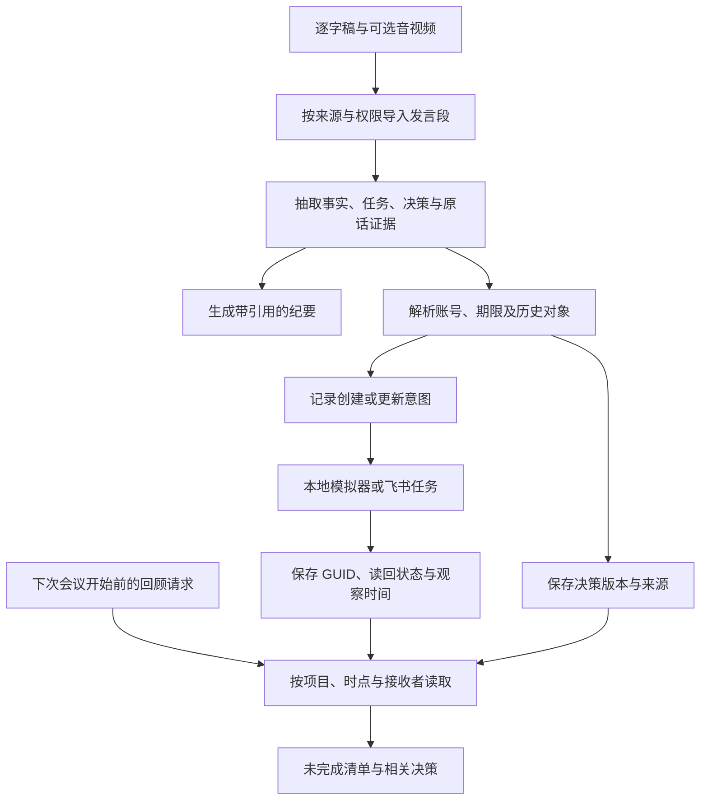

# 飞书会议行动项与决策追踪 · 技术设计稿 v0.2

2026-11-13 · 供架构与标注口径评审

例会开始前，主持人打开回顾，能看到上周谁答应交什么、哪些任务在飞书里仍未完成。会上有人说“那三个案例已经发群了”，会后应更新上周的同一条任务。试点范围后来改了，团队成员仍能查到旧决定何时有效、新决定来自哪句原话。每位查看人只收到其有权读取的内容。

**本月先交付标注集、离线评分脚本和基线错例报告。** 首版以会后妙记逐字稿为拟定入口，Python 承担导入、回放和评分，SQLite 保存任务绑定、状态事件和决策版本。整场可见转写是完整会议抽取的首个对照方案。[交付标准](acceptance.md)

2026-11-14 已取得 30 个公开片段、完成 35 条事件初标，并用 deepseek-flash 跑完 21 个开发片段的直接抽取基线。核心证据严格匹配 F1 为 72.0%，会前清单和数据校验脚本也可运行。用户已选择暂用初标推进，下一步搭建 M1 到 M2 的离线完整链路。实际数据、当前评分范围、试行规则和实施顺序见 [开发交接](HANDOVER.md) 与 [基线报告](baseline-v1.md)。

## 用两场例会定义正确结果

| 时点 | 系统当时能知道什么 | 应产生的结果 |
| --- | --- | --- |
| 11 月 9 日，会后 | 王宁问谁整理三个登录失败案例并发研发群；“说话人 2”答“我来，这周五下班前发群里”。本场名册能把这个标签映射到陈可。 | 用 M1.1、M1.2 两段作为证据，新建一条任务，示例 GUID 为 T17。到期日为 11 月 13 日，具体钟点留空，保留“下班前”原话。监控面板提议暂缓，进入纪要的未决项。 |
| 11 月 16 日，09:59:59 | T17、共享任务 T18 仍未完成，T19 已于 11 月 13 日完成。主持人能读三项，外协只能读 T18、T19。 | 主持人的回顾列 T17、T18；外协的回顾只有 T18。两份回顾都使用此时的任务快照。 |
| 11 月 16 日，会后 | 陈可确认案例已发。王宁将首批灰度范围由“只限员工”扩为“员工和试点客户”。 | 按试行口径，用 M2.1 更新原任务 T17；平台确认后记为完成。用 M2.2 生成范围的新版本 D2，指向旧版 D1。11 月 9 日的决定和 16 日会前的回顾均可重放。 |

这里的录制时间、账号和 GUID 都是模拟值。输入与答案分开存放，回放程序按上表时序逐步供数。[首场逐字稿](../examples/m1.json) · [会前状态](../examples/before_m2.json) · [次场逐字稿](../examples/m2.json) · [预期结果](../examples/expected.json)

## 运行架构与数据边界

离线回放由一条“会前回顾”事件触发，带会议系列、截止时点和接收人。联调时由会议日程触发同一入口，先定位已绑定系列，再读回此前任务；系列归属不明时保留待关联事项。模型接收已经按读取身份过滤的材料。共享稿还要在生成前按实际受众求可见范围交集。

| 数据对象 | 保存哪些信息 | 谁使用它 |
| --- | --- | --- |
| 会议与证据 | 租户、项目/系列、会议 ID、开始时间与时区、原件版本、发言段 ID、说话人原标签、原话、可用的时间窗或共享页定位 | 导入器、抽取器、引用回放 |
| 任务候选与写入意图 | 交付物、承诺/指派方式、账号映射依据、期限原话及精度、证据引用、本地行动项 ID、执行身份、首次发送时间、client_token、回执 GUID | 任务解析器与写入适配器 |
| 任务事件与决策版本 | 目标对象、变更字段、旧值、新值、业务生效时间、系统获知时间、来源、平台读回结果；决策另存同属性的版本关系 | 会前快照、历史查询与评分器 |
| 权限与评测答案 | 资源、读写动作、主体、受众、授权变化；评分端另存应见、禁见、预期操作及证据 | 回放程序先过滤输入，评分器独立核对。完整快照和标准答案只供测试端使用 |

首版取用旧项目的行动项字段、修订引用和缺样本计分规则。原项目的文本回放会清空说话人，故在导入处读取并保留原始标签。跨会议集合已有“同一议题的两个未决事项并列”测试，适合扩成“相关但独立”和“明确替代”两个对照。[本地复用位置](research.md)

## 输入与标注

主评测直接向模型提供逐段发言者及上游可解析的身份。模型依据话语判断任务负责人。例如陈可向王宁分派工作，展示陈可发言，负责人可以是王宁。人工事后补认的身份单独用于诊断；评测输入、任务答案和已有任务快照分别供数。[首批输入和字段约定](../data/pilot/sources.md)

**首版输入。** 用公开示例约定逐段文本格式，保留说话人、原有时间戳和发言正文，同一段另有稳定 ID 供标注引用。缺失时间保留为空。公开数据中的已知说话人身份对模型可见。飞书原生 TXT/SRT 解析在接入测试空间时单独验证。[格式标准与已定位片段](../data/pilot/sources.md)

**首批样本。** 优先从带人工标注的公开多人会议取样。AMI 系列会议用来复核原话、视频和跨会关联；中文 AliMeeting4MUG 用行动句定位候选，MISP-Meeting 可在取得授权后使用普通话全景会议视频和多通道音频。现有模拟快照继续承担账号权限和任务回执用例。公开语料和模拟流程分别报告，按整个会议系列划分开发与验证。[样本位置](../data/pilot/sources.md)

**多模态证据。** 对“这页第二个方案我来”，先标原话时间窗、发言人、共享页和该页上的方案。播放起点不同的音视频，用可辨识的切页动作校正偏移。构造同段原话配正确页、相邻错页和缺页三个条件，分别看对象能否解析、页码是否引对、缺页时能否保留未知。对“甲提问、乙认领”，固定文字只替换人工校正过的说话人标签，检查负责人错误是否消失。需要听音才能判的边界误差只在有人工校时的媒体子集计算。[多模态实验设计](methods-study.md)

## 抽取与写入策略

整场抽取先输出关键事实、未决问题、任务实例与决策，每项带发言段引用。程序再解析责任人、期限和应执行操作。标注者单独记录“出现行动表达”“形成会后交付”“允许写入”三个判断。同一发言可以承诺两件独立交付的事，多段发言也可能共同形成一件任务。遇到“周五，不，改周一”，两处时间都留下证据，任务的最终期限采用周一。[标注指南](annotation.md)

对照模型时固定转写、提示版本和输出字段，比较整场抽取、候选窗口抽取、给定人工证据窗口后的抽取。人工窗口改善结果，说明应先定位漏掉的原话；输入正确证据仍填错负责人，就检查指代与名册。飞书原生待办作为同会议的独立产品基线，另存为预测。纪要里的每条已决、未决和行动仍以原话核验。

| 事件 | 程序行为与验收结果 |
| --- | --- |
| 首次明确承诺 | 同一事务保存本地行动项及待发意图，再调用适配器。每项意图有稳定 ID 和唯一绑定；并发消费同一项只生成一条待发操作。回执关联 GUID。 |
| 创建实际成功但响应丢失 | 同一调用者在平台成功后 5 分钟内可复用同一 token。客户端按首次发送时间保守判断。超过窗口或换调用者，先查持久化绑定及可唯一识别的业务记录；仍不确定时保留“结果待核对”。重复标题无法证明是同一任务。 |
| 已有任务改期或重新打开 | 按 GUID 指定本次更新字段并读回。改期只改 due，误把未赋值字段列入 update_fields 会清空旧值。重开任务后，下一次会前快照重新列出原 GUID。 |
| 负责人自报交付 | 单负责人、目标唯一时，试行按自报完成原任务；会签中一人汇报只记个人进展。保留口头证据与平台回执。若读回已完成，跳过重复完成；遇到冲突保留两种来源。 |
| 来源修订、无法读取或权限变化 | 修订后先与原绑定核对，按字段提出变更。区分已删除、当前无权和读取失败。读取失败保留任务状态未知；撤权后立即从该查看人的候选、引用及缓存中移除受限内容。 |

任务写入同时检查执行者能否编辑目标，以及写入的标题或描述能否向目标清单成员披露。模拟器和飞书适配器使用相同的创建、读取、更新契约；真实联调分别留请求意图、回执和字段读回值。[飞书平台契约](platform-study.md)

## 跨会议关联与权限

**写入时按属性建版本。** “灰度范围扩大”只更新项目的首批受众属性；“截止日改到周一”只更新任务期限。用有方向的替代边记录新旧值，旧值保留来源及有效区间。历史查询先按系统当时已知信息截断，再解析业务生效时间。这样，周一会上才听到的“我周五已发”不会被写回周一会前回顾。首版用 SQLite 版本表实现这一查询；多跳依赖确实导致漏查时，再与时序图做同数据对照。[EvoWiki 方法及应用边界](methods-study.md)

**读取时先限范围，再找证据。** 先按租户、查看人、项目和可知时间确定候选。显式 GUID 或来源链接优先；缺少引用时，比较交付对象、负责人、前次日期及原话。同名候选无法唯一定位就保留歧义。对开放式问答，先用词法检索找候选会，再在会内选证据。返回多个窗口时在相同 token 预算下比较覆盖率和无关段占比；语义改写造成候选漏召回时，再评混合检索。

这项设计来自一次可复现的诊断。在同一设计团队四场英文会议的 29 道题中，已知正确会议时，BM25 首窗有 14 题碰到证据。允许四场参与后，22 题选对会议，只有 12 题首窗碰到证据。故“选择会议”“找回完整证据”“根据证据答对”分别评分。线上会前回顾只使用查询时点以前的材料。该实验衡量英文切片的检索表现，中文任务关联需要独立标注。[实验条件与错例](corpus-study.md)

任务、妙记引文与衍生决策分别判权。外协即使有权看到 T18，也不能从共享摘要、来源标题、数量提示或引用预览得知 T17。历史问题仍按查看人**当前**权限展示；已撤权资料不能通过查询旧日期重新取得。测试同一查询切换主持人、外协、只读关注人，并记录合法结果、模型收到的候选、用户看到的字段和实际写入结果。[权限测试矩阵](methods-study.md)

## 离线评分与交付顺序

| 评测对象 | 首版报告必须回答的问题 |
| --- | --- |
| 行动项及纪要 | 任务按交付动作与对象一对一匹配，多建计 FP、漏建计 FN；证据重叠辅助定位，同义改写由人工裁决。对匹配项分别报负责人、日期及证据，并统计未知字段被虚填的次数。纪要分别报关键事实覆盖与无依据断言。 |
| 回顾与状态 | 对每个“会议、查看人、时点”比较应见与实际 GUID 集合。核对写操作类型、目标、重复创建数与平台读回。会前快照、会后状态、操作日志分别检查，防止最终状态碰巧正确。 |
| 决策与证据 | 分别核对关系方向、属性、时点和引用。报告选对会议数、首窗命中数、人工证据覆盖率、窗口内证据占比，以及答案能否由可见证据支持。 |
| 权限与失败 | 固定越权回归要求受限候选进入模型、输出泄露及越权写入为零，同时报告合法任务召回。缺预测保留在样本分母，零分母输出 null。报告附原件和标注版本、样本数、预测、错例原因、耗时及模型用量。 |

1. **标注走读。** 用现有两场样例和 VCSum 负例复核承诺、会前时点及可见范围；明确指派但对方未答复时暂保留候选。标注版本随业务口径单独管理。
2. **离线评测首版。** 将公开会议逐字稿转为示例格式，复核人工标注，运行抽取、任务实例评分与状态回放。报告按会议列出可追溯的错例。[清单评分器](../scripts/score_recap.py) · [检索实验](../scripts/probe_qmsum.py)
3. **飞书集成验收。** 在测试空间按同一意图创建、短窗口重放、改期、完成和重开；用两种身份复查任务与来源。实际导出格式、真实读写与权限结果在该阶段确认。[集成检查项](platform-study.md)

评审时需由业务方确认生产入口、指派与口头完工规则，以及回顾面向个人还是共享会议。前两项决定哪些动作算正确，接收范围决定每个身份的预期答案。
