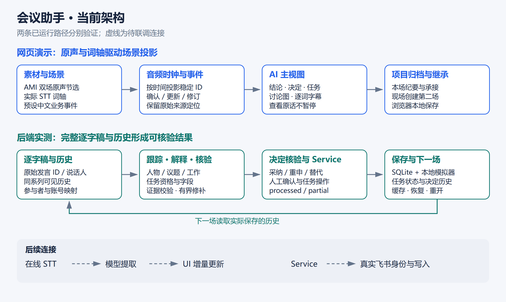

# 会议助手技术设计 · 当前实现

## 用户路径

在项目中进入首场会议，随原声查看字幕、议题、决定和任务；会后归档并查看项目承接，现场创建第二场、邀请原班成员，再跟随新一轮讨论更新状态。历史决定和原话保留，读者可以区分沿用、重申与修订。

图源为 [SVG](images/architecture.svg)，结构源为 [Mermaid](images/architecture.mmd)。早期 v0.2 设计保存于 [历史设计](design-v0.2.md)，其中拟定集成不作为当前完成项。

## 两条已运行路径

| 路径 | 输入 | 主要处理 | 输出与保存 |
| --- | --- | --- | --- |
| 网页演示 | AMI 节选音视频、实际 STT 词轴、预设场景事件 | 音频时钟驱动事件；稳定 ID 投影；自动确认 | 结论、任务、讨论图、原话；项目归档和浏览器存储 |
| 后端提取 | 完整人工逐字稿、账号映射、同系列可见历史 | 跟踪→解释→核验→有界修补；决定采纳与版本核验 | items、facts、unresolved、decisions、updates；Service、SQLite、本地模拟器 |

在线 STT 服务已能识别前端发来的 PCM，但尚未贯通模型提取和 UI 更新。真实飞书身份、任务和文档写入属于待联调连接。图中虚线只表示这些后续连接。

## 后端对象与状态

- **发言与证据**：保留原 segment_id、说话人和时间，模型引用 ID；程序验证引用边界，核验检查语义依据。
- **工作记录**：区分未来执行、报告、背景、建议与待澄清意向。items 与 review_records 共享记录标识，评分按 record_id 去重。
- **确认**：add_task 处理普通候选，adopt_and_add_task 处理待采纳建议，clarify_and_add_task 补全含糊意向。账号与承接满足后才能成为可更新的历史任务。
- **任务事件**：target_guid 指向已有对象；description、owner、time 和 status 的变化须有依据。不同会议的纪要虽动作相似，仍需要独立交付物范围。
- **决定**：有效清单与历史并存，reaffirms 表示重申，supersedes 表示替代。事实栏有同一内容不等于决定栏目已经更新。
- **处理状态**：processed / partial 描述提取交付，open / done 等描述业务任务。完成处理不能代替任务状态正确。

## 模块职责

| 文件 | 职责 |
| --- | --- |
| meeting_eval/context_v2.py、context_v5.py | 阶段编排、工作契约和覆盖核验 |
| meeting_eval/context_state.py、context_new_work.py | 工作记录与报告归并、确认资格 |
| meeting_eval/decision_review.py | 决定扫描、采纳依据、裁决和最终状态 |
| meeting_eval/minutes_review.py | 纪要核验与修补 |
| meeting_eval/service.py、store.py | 读取历史、保存结果、确认与查询 |
| meeting_eval/task_events.py、stage_runner.py | 任务状态变化；节点缓存与有界恢复 |
| demo/src/ProjectWorkspace.tsx | 项目、会议创建、成员邀请与归档 |
| demo/src/App.tsx、LiveWorkspace.tsx | 会议播放编排、当前 AI 主视图 |
| demo/src/minutes.ts、scenario.ts | 事件结构、时间投影与状态重建 |
| demo/src/useLiveStt.ts | 实时 PCM 请求与识别响应 |

## 恢复与复现

输出校验失败时，只在现有预算与次数内重试或修补，保存接受的阶段和原始失败。显式恢复经 Service.retry_extraction 执行；若输入、历史或阶段配置变化，不能把旧缓存当成相同实验。新推理使用新目录，已完成实验留档不覆盖。

当前完整配置为 context-v5 v19 + DecisionReview v2，默认 CLI 仍是 split-v3。便携入口、依赖和检查见[配置说明](CONFIG.md)，评测对象与保存路径见[证据索引](EVALUATION.md)。
