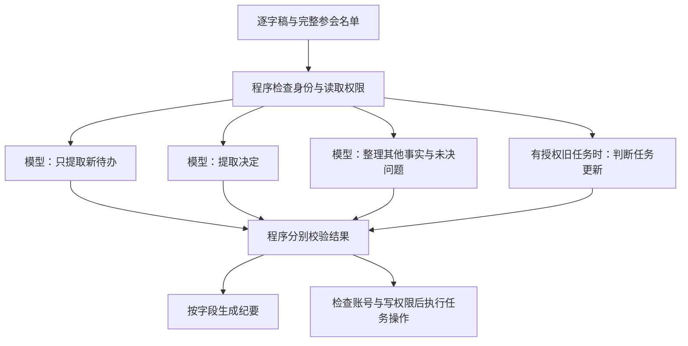

# 会议抽取问题与修复方案

> 实施状态：已按本方案完成工程修复、重复对照、保留集与全链路核验。实际收益、未采用的追加提示和剩余问题见 [修复结果](extraction-repair-results.md)。下文保留实施前的研究判断。

2026-11-14。当前系统能完成两场会议的状态回放，但完整抽取器比原行动项基线多漏了两条待办。建议先修复人员名单错误，再把待办抽取独立出来；纪要、决策和任务更新分别使用明确的输入与输出，由程序汇总。每增加一项能力，都要验证原来能找出的待办是否仍然保留。

本报告结合项目已保存的预测、13 次诊断请求，以及模型厂商文档和原始论文。报告中的流程与实验安排是本项目的建议，尚未实施；外部研究不能替代本项目实测。这里的“多任务”指一次模型请求同时承担多种工作。

## 当前问题及修复依据

| 问题 | 已有证据 | 应如何修复 | 用什么结果验收 |
| --- | --- | --- | --- |
| 待办只写进纪要，没进入任务清单 | C20 视频剪辑、C21 整理意见出现在 facts，items 为空；只换回基线提示词，两条恢复 | 待办单独提取，纪要复用这份结果；同一承诺允许同时出现在事实和待办中 | 原话中的承诺进入待办，纪要生成前后其负责人、期限和证据不变 |
| 人员名单漏掉没发言的参会者 | C07 participants 有四人，roster 只剩两人；正确负责人 ID 被 validate 拒绝 | 从完整参会名单建立统一人员表，加入当场身份映射；历史名册仍须按权限过滤 | 未发言但被指派的人可以成为负责人；未提供的人不能被虚构 |
| 承接和期限判断退化 | C02 的“Yep”未稳定算作承接；C07 把工作时段填成期限 | 保留完整业务规则，用“已承接/未承接”“工作时段/交付期限”的成对例子验证 | create/candidate 与负责人、期限分别计分，不藏在一个 F1 中 |
| 抽到任务与允许写入混在一起 | 模型输入包含 account_map 等执行信息；缺账号本来只应影响写入 | 抽取输入保留人员身份与原话；账号、写权限由程序在抽取之后处理 | 同一会议只改变账号绑定或写权限，抽取的待办不应消失，仅执行结果改变 |
| 格式正确被当成内容正确 | 21 个响应均有效，但新增两条漏项 | 分开记录响应有效、业务抽取和平台操作结果 | 能区分“没找到任务”“找到但被校验误拒”“找到但无权写入” |
| 单项校验失败可能抹掉整场结果 | run_meeting_eval.py 捕获异常后为该片段写 items=[]，错误另存 errors.json | 留存原始结果；区分模型错误与程序拒绝。业务侧无效项不能执行，已通过校验的结果能独立展示 | 注入一个非法 ID，其他有效结果仍可追溯，报告明确该场部分失败；失败不能伪装成“没有待办” |
| 测试覆盖了程序，却未覆盖真实抽取 | 多数测试使用 FixedExtractor；M1/M2 实测通过，但公开样例依然退化 | 保留程序测试，新增真实模型的固定开发集回归，并分别报告 | 状态测试通过与模型质量通过有各自证据 |
| 单次运行分数会波动 | 同一完整请求重跑，C02/C07 输出发生变化 | 候选方案重复请求，记录每次结果；不能用缓存当重复实验 | 报平均、范围、反复漏掉的样例，而不只挑最高分 |

其中，人员表与校验错误是确定性代码问题。提示词替换能恢复 C20/C21，支持提示设计是主要因素；目前还不能把影响精确分摊给“任务数量增加”和“原规则被压缩”。将平台账号信息送入抽取请求可能造成混淆，尚没有独立实验确认它导致了本轮漏项。原始对照见 [退化诊断](extraction-diagnosis-v1.md)。

## 外部方案中值得采用的部分

### 固定工作分步执行，每步只负责一种主要判断

Anthropic 将固定步骤的串联、独立工作的并行，以及步骤间程序检查列为常用工作流；Google 的提示设计文档也建议将复杂指令拆分后串联或汇总。它们支持的工程方向是减少一次请求必须同时完成的判断，代价是更多调用与等待。[Anthropic 工作流说明](https://www.anthropic.com/research/building-effective-agents) · [Google 提示设计](https://ai.google.dev/gemini-api/docs/prompting-strategies)

本项目对应的做法是：待办提取专门找承诺与分工，决策提取专门找已定事项和替代关系，最后按固定字段生成纪要。负责人、承接、日期属于同一待办的紧密关联信息，先留在同一个待办请求中，避免拆成多个互相传话的步骤丢失上下文。

### 用程序安排流程，不让模型决定是否跳过关键工作

LangGraph 官方文档区分固定代码路径的工作流与由模型动态决定步骤的 Agent。会议处理的步骤已知，适合固定工作流；普通 Python 函数就能实现这种模式，现阶段不需要为了拆请求引入调度框架。[LangGraph 工作流说明](https://docs.langchain.com/oss/python/langgraph/workflows-agents)

也不宜先让另一个模型判断“这段有没有待办”，再决定是否调用提取器。一旦第一步误判，真正的提取器就没有机会看到原文。当前短片段可以全部交给待办提取器。

### 写纪要时利用已有待办，不重新发现一遍

会议研究中已有将行动项提取与分段摘要结合的方案，最后形成围绕行动项的会议摘要。该研究报告的是摘要指标，不能将其结果当作本项目待办召回率的保证。[Action-Item-Driven Summarization of Long Meeting Transcripts](https://arxiv.org/abs/2312.17581)

本项目可以进一步把关键字段交给程序渲染：任务标题、负责人、期限和证据直接取自已校验结果。纪要写作只负责其他解释性内容。这样，“整理意见”即使在事实摘要中也出现，任务清单仍有自己的固定来源。

### 校验需要原话和明确规则，不能只有“再检查一下”

DeepSeek 的 JSON Output 说明保证的是合法 JSON 字符串。负责人 ID 存在、证据属于本场、日期能解析可由代码检查；是否漏掉承诺、工作时段是否被误当期限仍是语义问题。[DeepSeek JSON Output](https://api-docs.deepseek.com/guides/json_mode/)

关于自我纠错，ICLR 2024 的研究在其推理任务中发现，无外部反馈的自我纠错可能无效甚至变差。这不意味着所有审核模型都无用，但不能把泛泛要求模型“重新检查”当作质量保证。[Large Language Models Cannot Self-Correct Reasoning Yet](https://arxiv.org/abs/2310.01798)

如需补漏，单独给检查步骤原始发言和现有待办，只要求找“原话明确有承诺但清单没有”的项目，并附发言 ID。先统计它补回多少真漏项、又增加多少误报，再决定是否启用。审核输出仍需通过业务规则，不能直接创建任务。对于同类漏项反复出现，先改生成规则，避免无限返修。

### 拆分并不意味着增加 Agent 就必然更好

Google Research 的 agent scaling 研究发现，协作架构是否有效取决于任务是否适合拆开，顺序依赖强的任务可能因为协作而退化。本文参考 2026-04-08 的论文 v3；其配置数量与早期博客版本不同，不混用统计口径。[Towards a Science of Scaling Agent Systems v3](https://arxiv.org/abs/2512.08296v3)

本项目采用同一个模型也可以分工：每次使用不同提示词、独立上下文，由代码汇总。先保留明确的两三个功能边界，不引入自由讨论、投票或主管 Agent。只有下一步需要上一步结果时才串联，独立提取可并行。

## 建议的处理流程

第一步先把待办提取独立出来，使用已有行动项提示词作为对照，不同时修改所有判断规则。最终拟采用的完整版本中，事实与未决问题先共享一次请求，因为两者都服务于解释性纪要；如果它们自身的评测暴露明显相互干扰，再拆分。决策影响跨会版本关系，单独处理。

没有旧任务时不调用更新判断；有授权旧任务时，给它会前快照和本场原话。是否存在旧任务由程序确定，不用关键词预筛“是否说了完成”。各分支都使用同一个会前快照，全部完成前不写任务，避免一个分支把另一个分支刚建的任务误认成历史任务。

这些请求读取的是同一份有权查看的原话，而不是先生成的摘要。每个分支只接收完成本项工作需要的资料：待办分支不需要平台写权限，决策分支不需要整个任务清单。资料减少的前提是信息仍足够，不应把提问与承接拆开。

每类结果有固定归属：items 由待办步骤提供，decisions 由决策步骤提供，updates 由更新步骤提供，其他纪要由事实步骤提供。汇总函数只能合并和校验，不能再调用模型把所有字段重新生成一次。如果事实中出现一项清单没有的承诺，可以形成补漏候选；不能悄悄覆盖待办结果。

若一项同时被提议新建和更新，先核对明确绑定及来源证据，不能仅按相似标题删除其中一条。无法唯一确认的操作保留待关联。分支出错时展示哪项未完成，不将错误转换成正常空清单。

完整版本预计每场 3 次提取调用，有旧任务时再加 1 次更新调用，尚不包含可选审核。并行能减少等待，不能省掉重复阅读逐字稿的 token。是否值得采用，以同一批数据的质量、总 token 和整场耗时决定。

## 提示词需要保留哪些规则

待办请求首先问“会后谁要做什么”，输出任务内容、负责人、承接方式、期限原话与证据。是否能写进任务平台随后由程序判断。当前 create/candidate 兼容输出可以继续保留，但其含义必须限定为抽取规则中的可执行性，不代表真实平台已经授权。

下面四组例子应加入开发回归，提示词示例使用另外编写的句子，不复制保留集答案。

| 对照 | 应产生的区别 |
| --- | --- |
| “我们会把意见整理出来” / “要不要整理一下意见”且无人回应 | 前者是团队候选，后者是建议 |
| “你整理设计稿”“好” / 只有“你整理设计稿” | 前者可构成已承接，后者保留候选 |
| “午饭后做设计” / “周五前交设计稿” | 前者是工作安排，后者有交付期限 |
| “视频我剪好发群，文稿再说” | 只提取视频交付，不把视频的动作套到文稿上 |

同一发言可以支持多种输出。必须明确“记录为事实”不能作为排除待办的理由；反过来，识别到待办也不等于能补全原话未说的负责人、截止日或交付物。证据 ID 约束只能证明引用存在，不能自动证明描述受原话支持。

对于“输出很多字段就容易退化”，ComplexBench 的结果支持分别检查组合后的约束，而非只测每个约束单独表现。2026 年关于多目标 LLM 评审提示优化的研究也观察到组合指令后的退化，但场景是评审器，不能直接证明本项目模型内部的原因。两项研究都提供实验思路，而不是预计提升幅度。[ComplexBench](https://arxiv.org/abs/2407.03978) · [When Gradients Collide](https://arxiv.org/abs/2605.26046)

## 怎样验证修复有效

### 先修确定性错误

用 C07 的完整名单验证两件事：未发言的工业设计师和界面设计师仍在统一人员表中；原基线给出的正确负责人 ID 能通过校验。再测更换账号绑定、撤销写权限时，任务检出结果保持，只有执行状态改变。

这些测试不需要模型调用。修复名册后，所有新方案都使用同一份修正后的输入，避免把程序错误误算成提示词效果。

### 再比较最小变更与拆分方案

| 版本 | 改动 | 要回答的问题 |
| --- | --- | --- |
| R0 原行动项基线 | 原提示词、原输入；重跑作同期参照 | 原基线本身波动有多大？ |
| R1 行动项基线接入修正后的导入 | 只换输入组织方式，仍只找待办 | 修正后的导入是否保留了原能力？ |
| R2 完整抽取修订版 | 在单次完整输出中补全候选规则、类别关系与成对例子 | 只修提示词是否已足够？ |
| R3 分工版 | 待办与其他输出分开，程序汇总；待办请求与 R1 保持一致 | 其他功能开启后能否保留待办质量？ |

先用 C02/C03/C07/C09/C20/C21 做开发排错，再让进入正式比较的版本跑全体 21 个 dev 片段，各做至少 3 次真实请求。三次是本轮成本与观察波动的折中，不是充分的统计显著性证明；如果波动仍足以改变方案选择，再增加次数。每次使用独立数据库和运行目录，固定模型参数、原始输入、参考答案与评分版本。缓存复用可测试恢复，但不能计作独立重复。

R1 与 R3 的待办提示词和供数应一致。可以先重放同一份已保存待办输出，让其他分支生成不同内容，确认程序汇总始终保留待办字段。这个测试证明流程不会改坏已有结果；真实模型重跑再衡量概率性错误。

每版报告以下结果：

- 找对、漏掉、多报的任务数，P/R/F1；C20 不能靠重新加入文稿误报换取召回。
- 在同一批参考任务上的负责人、承接、期限与证据结果；共同命中项的字段质量另列，避免分母变化掩盖问题。
- 原来正确、此次变错的具体样例；C03/C09 的旧问题也保留。
- 纪要是否遗漏已有待办，是否新增无原话依据的断言；决策替代及任务更新是否仍正确。
- 模型输出失败、校验失败、执行被拒分别计数；原始响应留存。
- 每场总 token、调用次数、整场耗时，以及 M1/M2 与权限回放结果。

当前评分器按核心发言句匹配任务，适合延续比较，但不是完整的语义正确性评分。评分有争议的任务保留原话对照，不通过修改答案或换匹配方法制造提升。参考答案仍是初标；有歧义的地方记录具体影响，不把代理标注冒充人工复核。日期正例不足继续用明确日期合成场景测试。保留集 9 个片段在方案固定后使用。

只有单次 F1 超过 72% 不足以宣布修好。应同时看到：确定性缺陷消失；重复运行中关键漏项得到改善；整体召回和误报取舍可接受；写入与权限功能保持；额外成本有实测收益。若单次完整提示的修订方案已达到同样效果且成本更低，就采用较简单方案。

## 较长会议如何处理

本轮错误发生在短片段，现阶段不能归因于上下文太长。后续长会议另做按议题分段的对照，保留相邻发言和完整身份表，逐段提取后按任务实例合并。重叠窗口要防重复创建，提问、回答和改口不能在切分边界丢失。不能只从压缩摘要反推全部待办。

《Lost in the Middle》在其多文档问答与检索任务中发现相关信息位置会影响结果，说明长上下文“放得下”不等于“用得好”。它支持测试会议前、中、后部和跨段承诺的覆盖率，但不能据此断言当前模型在本项目一定有同样程度的问题。[Lost in the Middle](https://aclanthology.org/2024.tacl-1.9/)

## 实施位置

| 顺序 | 文件或模块 | 工作 |
| --- | --- | --- |
| 1 | meeting_eval/inputs.py、extract.py、tests | 补齐统一人员表，修正合法人员校验，验证完整 participants 与输出身份的一致性 |
| 2 | prompts 与模型调用模块 | 为待办保留独立提示和输入投影；保存每一步请求、响应、错误与耗时 |
| 3 | meeting_eval/service.py | 接入分项结果，校验后统一持久化；渲染纪要使用已有任务字段，写操作继续走权限与意图机制 |
| 4 | scripts/run_meeting_eval.py 与评分产物 | 支持版本、重复运行、分项错误及字段对照；运行身份与模型配置写入实验记录 |
| 5 | 开发报告 | 按同一口径比较 R0—R3，选择达到质量要求且成本合理的方案，再检查保留集 |

这次调研的建议重点是保住已验证的待办提取能力，再增加其他能力。分步调用、程序校验和独立评分各自处理不同类型的错误，最终是否降低错漏率仍以项目数据判断。
