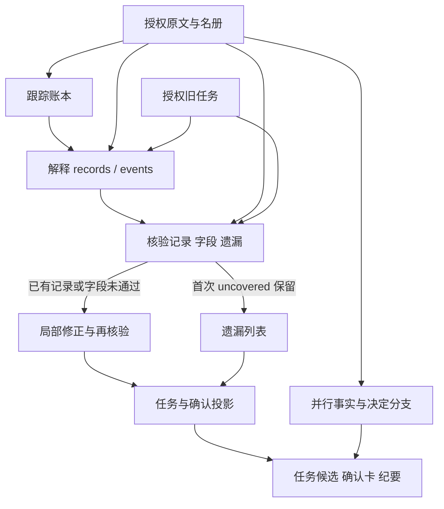

# M2及相邻失败：分类、修正和确认链路的系统根因

2026-11-15。目标是让用户得到原任务的正确更新、会议决定和真实新增工作，同时不必回答系统自己制造的负责人、期限或指代问题。本轮从最新M2复测继续调查，扩查C20、P07b及结构失败，形成[解决方案草案](superpowers/specs/2026-11-15-m2-system-design.md)。

原始M2“登录改版第一批的范围今天改一下，内部员工和试点客户都开放”在一次完整跨会中先被正确解释成范围决定，再被核验推翻，最终生成范围任务候选和两张确认。另一次相同配置运行通过。问题由模型的语义判断波动与程序处理这些判断的方式共同构成；现有证据不能把它归结为某一句提示或单一模型能力。

## 1. 调查方法与证据范围

读取当前跟踪、解释、核验、修正提示，`ContextPipeline.run`、`reduce_context`、证据校验、任务投影、确认接口与纪要展示；对照当前阶段测试。检查最新跨会失败/成功、旧单独M2、C20、P07b和落实正例的原文及首次/修正后输出。

用当前规则离线重放上述六份结果，逐份比较 `items/updates/pending/review_records/item_records/reports/context_records`，42项比较全部相同。另做四个确定性干预，只改变一个输入条件或用受控客户端返回预置输出，不调用真实模型：

| 干预 | 结果 | 能说明什么 |
| --- | --- | --- |
| 只去掉失败跨会的 `uncovered_spans` | U确认消失；错误范围candidate和R2确认保持 | 重复遗漏与范围误判是两个机制，删遗漏不能修好分类。 |
| 给正确 `context_only` 输出带回同一旧遗漏 | 无任务，但仍生成一张U确认 | 正确分类不能自动关闭旧遗漏，状态合并缺少这一关系。 |
| 只清掉P07b记录的 `reference` 缺口 | 已支持的同一个事件变成一项create提议 | 缺口标记是此例的直接阻断点；不证明应全局清除指代缺口。 |
| 新增真实工作原话，核验仅报告该遗漏、其余已有记录均通过 | 只运行track→interpret→check，未触发repair | 没有关联失败记录的独立遗漏没有进入修正的入口。 |

证据：[原文与阶段结果](../runs/2026-11-15-m2-system-diagnosis/evidence.json)、[规则重放](../runs/2026-11-15-m2-system-diagnosis/routing-replays.json)、[四个干预](../runs/2026-11-15-m2-system-diagnosis/probes.json)、[结构输出审计](../runs/2026-11-15-m2-system-diagnosis/protocol-audit.json)、[可复现脚本](../experiments/task-boundary/diagnose_m2_system.py)。干预后的输出是诊断材料，不能算模型改善或生产修复。

## 2. 按问题类别定位

| 类别 | 具体表现与触发条件 | 系统中的直接原因 | 证据边界 |
| --- | --- | --- | --- |
| 工作资格判断不稳定 | M2把范围决定变成工作，再把决定发生的“今天”赋给任务截止日期 | 跟踪/解释/核验都可重写其话语用途；字段齐全与引文真实不能证明工作确实存在 | 路径已观察；前序解释是否造成核验偏差尚未受控验证。 |
| 错误核验推动修正 | cross-r1正确context_only被核验改判work；C20核验要求把文稿接到“给大家确认”，修正后另一轮核验又否定该动作 | 同一个verdict既表示质疑又选定修正目标；核验理由只以文本传递，没有区分“原文冲突”“一种替代解释”与“用户未决定” | 已定位具体翻转；不能据此断言修正总会变差。 |
| 遗漏缺少身份和生命周期 | 同一M2.2既有R2争议又有U遗漏；修正后U残留 | uncovered只有整段证据，无“遗漏的哪项工作”、对应记录、关闭结果；局部修正只处理已有record ID | 代码和四个干预中的三项直接支持。 |
| 用户问题与系统不确定性混用 | C20错误动作被判不足后仍问“内容、负责人、是否执行”；M2分类争议也进入同样问题 | reducer对未进入有效操作的记录生成review，默认问题预设有一项工作；`can_add_task`主要限制旧任务关联，不能证明提问前提成立 | 确认并非自动创建；风险是误导和额外决策负担。 |
| 缺口没有表达其影响范围 | P07b动作、负责人、承接等均supported，却因场景名称省略不产生任务 | `missing_fields`只有字段名；reference/scope/work/relation被整体用于阻止任务，没有区分可保留的原话指代与影响执行方向的竞争解释 | 当前场景目标允许保留“这个场景”；不要求系统猜具体场景名称。 |
| 证据与输出协议不一致 | positive-r1把发言人姓名当正文引文；C19/P08b引文定位失败；P07a缺time.change | 角色元数据与逐字引文使用缺少类型区分的表达；生成示例、后加规则与校验器分散维护；单个结构错误终止本次任务分支 | 错误与代码可复查；“提示长度导致失败”没有受控证据。 |
| 评测未覆盖用户可见结果 | 旧12项跨会通过，但有candidate和两张确认；旧单独M2预期还要求追问负责人 | 持久化任务数不覆盖候选与确认，旧预期与当前场景约定未统一版本 | 影响如何解释“通过”；本轮没有改标签重算旧成绩。 |

## 3. 根因怎样沿数据流传播

### 3.1 语义上应分开的判断，在协议中仍互相代替

`context_only`已经解决了“有用非任务内容无处保存”的旧缺口，不能继续把“缺少类别”当成当前M2的完整根因。现在三个提示都明确区分决定与落实工作，也明确禁止重复遗漏；错误仍出现。这说明约束存在，但未形成稳定的判断和合并结果。

当前至少有四个不同问题：原文是否表达工作；动作/对象能否忠实记录；是否需要用户补充某个决定；是否满足平台执行条件。M2首先错在第一个问题，日期和负责人错误随之产生。P07b工作与承接正确，问题出在把名称省略当成阻断缺口。C20则在核验争议之后，直接进入预设任务存在的提问。统一“收紧”会伤害P07b；统一“放宽”会放过M2和C20。

### 3.2 核验本身是模型判断，修正不提供额外事实

cross-r1首次解释为范围决定，check以“今天改一下”为依据质疑，repair按该质疑改成work，recheck接受。cross-r2的跟踪仍标work，解释却纠正为context_only，check也接受。不能说“跟踪错误必然使核验错误”。

C20更直接：首次check要求把“这个文稿可以吧”接到前面的共同确认安排；repair补成“文稿与视频一并给大家确认”；recheck又指出原文没有这个动作。两次检查给出的任务边界判断互相冲突，原文没有变化。系统保留了trace，但最终路由没有一种专门表达“提问前提仍是系统争议”的方式。

当前所有阶段使用同一模型；check和recheck看到前序ledger/records/events。前序解释影响、同模型相关错误、核验关闭推理的影响都是可检验假设，尚不能排序为已确认原因。增加修正轮数不会自动获得外部事实，还可能放大错误反馈。后续应比较等调用、同原文的visible/blind实验，而不是把新增一次模型调用的收益都归给“独立核验”。

### 3.3 遗漏列表表达的是证据位置，却被当作独立工作

`check_work`通过Q编号报告遗漏，程序扩展成整段原文。协议只知道“这一段可能漏了东西”，不知道“另一项动作是什么、与已有R2是什么关系”。两个真实动作可以同段，决定与实施工作可以共享证据，因此不能直接按段号去重。

`ContextPipeline.run`的targets只来自记录和事件的失败检查，uncovered不参与；repair又要求输出目标ID原集合，不能创建全新的遗漏record。recheck被固定要求uncovered为空，合并时未更新首次遗漏。因此，独立遗漏既没有补回入口，也没有判断已经覆盖的出口。`reduce_context`仍逐个span创建U记录，`Service.minutes`还会通过pending再次展示“待核对工作”。这是协议和状态转移缺口，不是再加一句“不要重复”能确定性保证的行为。

### 3.4 证据选择的机械负担与语义判断混在一次生成里

解释示例JSON没有 `time.change` 和 `other_changes`，后文追加规则和校验器却要求二者存在。P07a恰好缺time.change；进一步读原始响应发现C19也缺该字段，但先被重复引文错误截住，未在首次错误摘要中显示。只能确认规范分散且示例不完整，不能认定它是模型遗漏字段的唯一原因。

`align_spans`把“引文根本不存在”和“多次出现但未给occurrence”统一报为 `Missing or ambiguous exact quote; provide occurrence`。positive-r1的“陈可”属于前一种，增加occurrence无效。实体建模又要求每个实体有正文mention，即使原始speaker/roster已能提供身份，也可能诱发模型重复造引文。提示已要求不要这样做，结构上仍允许模型提交这类字符串直到末端校验才失败。

目前严格拒绝错误证据是必要的；改善方向是减少需要模型自由生成的机械字段，分清正文位置和角色元数据来源，并精确报告失败位置。是否进一步保留同一批输出中独立有效记录，要先验证依赖关系，不能靠忽略错误直接恢复执行。

## 4. 调研结论与适用边界

本轮查阅原论文与官方文档，以下是设计依据，不是本项目已验证的效果。

| 来源 | 研究或规范给出的依据 | 本项目可采用的做法与限制 |
| --- | --- | --- |
| [Purver等：多方对话行动项提取，2007](https://aclanthology.org/2007.sigdial-1.4/) | 先识别包含提出、讨论和承接的子对话，再提取任务属性；任务承诺区别于一般策略决定 | 用动作、归属、承接之间的关系判断任务，不靠“改一下”等词。论文的行动项定义较窄，本项目仍保留未接受分派和条件候选。 |
| [Bunt等：对话行为标注，2010](https://aclanthology.org/L10-1385/) | 区分交际功能、内容和响应依赖；同一片段可具有多种功能 | “决定+实施”分成语义记录，允许共享原文；借用概念，不引入完整ISO标签体系。 |
| [Chain-of-Verification，ACL 2024](https://aclanthology.org/2024.findings-acl.212/) | 比较将核验回答与初始答案分离的生成方法 | 为visible/blind对照提供依据。其事实生成任务不同于会议语用，不能保证本项目有效；最终合并仍可能引入错误。 |
| [CheckList，ACL 2020](https://aclanthology.org/2020.acl-main.442/) | 用最小功能、答案不变扰动及预期变化扰动检查行为 | 每个负例配真实任务、竞争指代及同段第二任务，分别检查任务、确认和状态，避免只看总分。 |
| [W3C Web Annotation：文本选择器](https://www.w3.org/TR/annotation-model/#selectors) | 区分源资源、文本引文与位置，重复引文可由上下文定位；位置依赖具体源版本 | 由程序保存稳定原文位置和版本，模型选择引用ID。该规范不保证引文在语义上支持工作，只解决定位与追溯。 |
| [DeepSeek JSON Output](https://api-docs.deepseek.com/guides/json_mode/) 与 [strict工具调用](https://api-docs.deepseek.com/guides/tool_calls/#strict-mode-beta) | JSON模式约束JSON格式，strict模式约束受支持的函数参数schema | 当前客户端使用json_object；必填字段可考虑schema约束，正文蕴含、跨记录一致性仍需程序/语义检查。strict需要独立验证当前端点能力，本轮未做兼容性调用。 |

## 5. 优先级与仍需验证的问题

优先修订遗漏身份/生命周期和确认资格的约定，因为它们决定模型输出如何变成用户负担，并已有确定性重放依据。M2语义判断另做局部对照：先比较现有阶段内更明确的判断依据，再以等调用visible/blind检查前序解释的影响。完整schema示例统一可作为独立的小改动；证据引用ID迁移单独验证结构成功率和语义保真，不能把结构恢复收益算作任务边界收益。

设计仍需实验回答三件事：分类是否看前序预测会改变正确率；更明确的缺口/问题证据能否同时减少M2误问并保留P07b工作；引用ID协议能否减少结构失败而不让整段证据掩盖字段错配。现有调查已给出输入、比较方式及失败判据，见方案草案。
