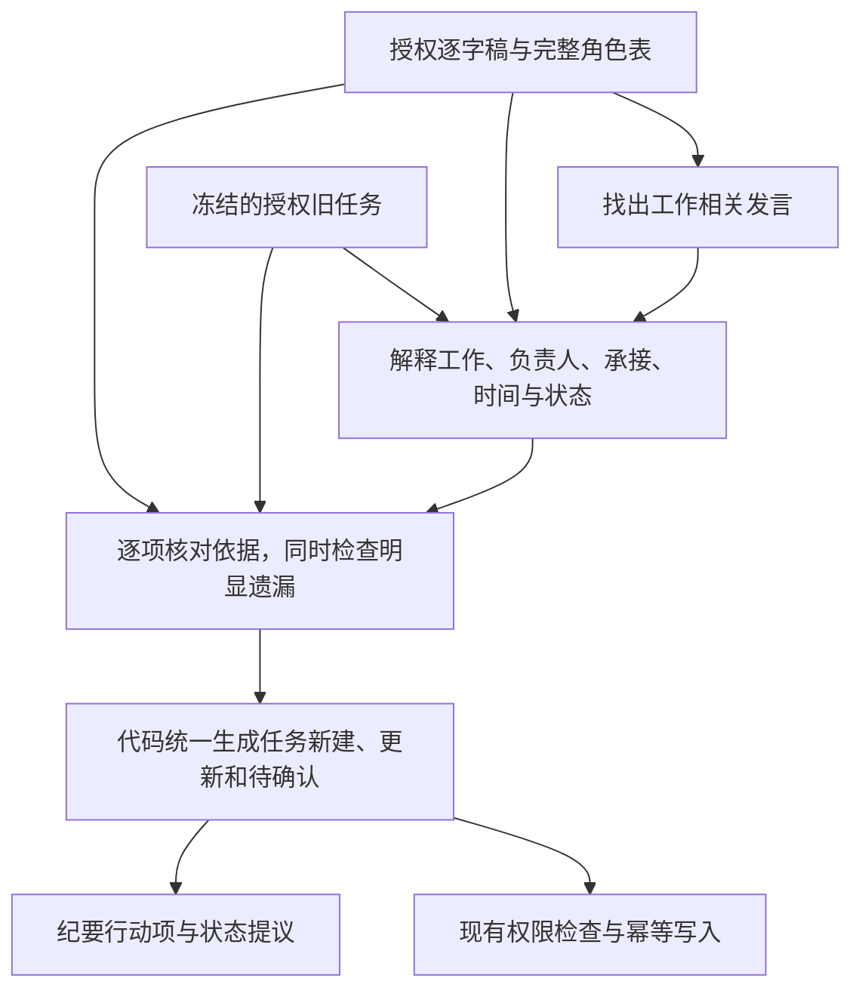

# 行动项语义评测与证据处理流程实施方案

> **For agentic workers:** Use `superpowers:executing-plans` to implement this plan task by task. Steps use checkbox (`- [x]`) syntax for tracking. 实施与小样本验收已完成。勾选表示已有实现或验证证据；未勾选项是质量门槛未通过而未启动的扩展。结果见 [实施报告](../../action-evidence-results.md)，执行取舍见 [记录](../../../runs/2026-11-14-evidence-implementation/progress.md)。

**Goal:** 减少会议行动项的跨句漏提、无依据动作和错误承接，并能定位错误发生在哪一步、用同一口径验证改动是否有效。

**Architecture:** 保留当前 Python、SQLite、CLI 和任务模拟器。新增可选策略 `evidence-v1`，由“找工作相关发言 → 解释工作与承接关系 → 核对结论”三个有独立记录的步骤产生事件，再由代码统一生成新建、更新或待确认结果。先补语义评测，再比较该策略与直接抽取；验证有效后接入默认流程。

**Tech Stack:** Python 3.11+、标准库、SQLite、现有模型兼容接口。第一阶段不新增运行时依赖；LangExtract、MiniCheck 作为有明确验收目标的可选实验，GEPA 放在评价标准稳定之后。

**Spec:** [系统溯因报告](../../action-architecture-diagnosis.md)。本方案把其中的建议落实为接口、数据边界、实施任务和验收条件；新增取舍是本次方案建议，不代表已经验证有效。

## Global Constraints

- 沿用 Windows 本地环境；项目目前没有 Git，使用新输出目录、配置快照和代码哈希保留版本，不创建提交或操作同级项目。
- 旧 `data/mvp-v1`、52 次诊断原件及历史分数保持可复现。新标注、新输入范围和新评分分别版本化。
- 模型仅接收逐字稿、身份语义和已授权历史；标签、评测预期、平台写权限与账号映射不进入语义提示。
- 第一阶段继续使用项目初标与代理复核，保留复核者、依据和不确定性，不等待新增人工确认流程。
- `Service.process`、`Extractor.extract`、`Extractor.retry` 的业务入口继续使用；权限、幂等写入、回执恢复和来源修订规则沿用当前实现。
- 对已有 `split-v3` 保持可选择、可回放；只有第 7 项验收通过，才讨论将默认策略切换为 `evidence-v1`。
- 错误、语义不确定、没有任务是三种不同结果；模型调用失败不能转换成“没有任务”。
- 评测结论只覆盖实际验证的输入。现有 9 个保留片段已参与分析，后续不得称为未见测试。

## Review Focus

- 同一句包含两项工作：不能因为引用相同就合并；正确工作夹带假动作也不能算完全正确。（任务 1、4、5）
- 回应同时夹在多人发言中：按说话人和对话关系判断承接，不能把最近的 Okay 自动归给上一项工作。（任务 4）
- “这段时间做”与“到时交付”：正文和结构化时间必须一致，不能一个留空、另一个承诺完成。（任务 1、4、5）
- 原文同时出现旧任务完成和新任务分派：各自关联一次；关联不清的工作不能被当成新任务直接创建。（任务 5、6）
- 中途失败后重跑、或恢复时权限发生变化：已成功步骤保持原结果，任务写入不能重复，旧上下文须重新检查访问权。（任务 3、6）

---

## 一、路线选择和首版边界

| 路线 | 收益与限制 | 本方案选择 |
| --- | --- | --- |
| 只开启推理模式 | 已有实验支持它改善部分跨句漏项；仍有文稿推断和建议误报 | 保留为重要对照，衡量复杂流程是否值得 |
| 分步记录证据、解释关系、核验内容，再统一处理任务 | 能单独检查召回、理解和执行；增加调用和延迟，效果待验证 | 作为候选实现 |
| 直接引入完整 Agent 框架或自动提示优化 | 不能自动补齐当前标注和评分缺口；增加调试变量 | 当前阶段不采用 |

首版的改动集中在行动项，包括新工作与已有任务的状态汇报。事实与产品决定仍沿用已有独立分支；纪要中的行动项及任务状态提议从新流程生成。先验证这条核心路径，暂不重写整个纪要系统。

输入使用调用方提供的完整文本范围。当前短片段和模拟会议均整体传入三个步骤，保留原文，不先压缩成摘要。补前文作为独立的数据视图验证；长会议的自动切分、检索和路由要等这条核心路径有效后再做，届时以完整“提出—回应—补充/否定”关系为边界。

## 二、必须先定下来的数据与判断规则

### 1. 三个模型步骤分别负责什么

| 步骤 | 输入 | 输出 | 不在这一步决定的事 |
| --- | --- | --- | --- |
| `locate_work` | 逐字稿、角色表 | 工作相关候选及其原文跨度，包括建议、分派、承诺、进度和完成报告 | 不决定是否创建任务；不因未承接或没有个人负责人而过滤 |
| `interpret_work` | 同一原文、候选、授权旧任务 | 工作内容、负责人、承接状态、时间性质、状态变化及旧任务关联，每项附证据 | 不处理平台账号和写权限；不发出写操作 |
| `check_work` | 同一原文、上述事件、授权旧任务 | 每项判断是支持、反驳还是证据不足；以及原文中明显遗漏的工作跨度 | 不重新自由生成另一整份任务清单，不自行补写未支持内容 |

检查步骤必须读原文，不能只读前一步摘要。它同时接收所有候选，包括没有进入最终任务的候选，避免 C09 那样在分类后无声消失。空候选列表也要经过检查；若发现遗漏，保存具体原话并标为待核对，不把空列表直接当成成功。

首版不增加自动循环返修。遇到语义不确定，保留问题供下一次改动或新输入解决；遇到传输、解析、结构错误，复用已有失败恢复机制。核验器也可能判断错误，其作用由独立语义评测决定，不能自评自证。

### 2. 中间记录的最小契约

以下类型在 `meeting_eval/task_events.py` 中定义为 `TypedDict`，实际存为 JSON。

- `EvidenceSpan`：`segment_id: str, start: int, end: int, quote: str`。位置是原始段落文本的 Python 字符索引，半开区间；必须满足 `text[start:end] == quote`。不对改写或模糊匹配直接放行。
- `WorkCandidate`：程序分配的 `candidate_id`、`spans: list[EvidenceSpan]`。同一发言可有多条候选；相同跨度本身不证明是重复任务。
- `TaskEvent`：程序分配的 `event_id`、`candidate_ids`，以及下表中的判断。模型引用已提供的候选 ID，程序分配事件 ID 和解释步骤补出的候选 ID；这些 ID 不是平台任务 GUID。

| 判断 | 必需字段与取值 |
| --- | --- |
| 工作 | `description`：只写动作与对象；`evidence`。核验覆盖完整描述，不能只核对抽出的关键词 |
| 负责人 | `kind: person/group/speaker/unknown`，`ref`、`label`、`evidence`；个人 ref 必须来自名册 |
| 承接 | `kind: suggested/assigned/self_committed/accepted/declined/conditional/unknown`，`evidence`；accepted 需明确指向谁接受哪项分派 |
| 时间 | `kind: deadline/work_window/unspecified`，`text`、`date`、`evidence`；工作时段不转截止时间 |
| 状态 | `kind: future_work/progress/completed/reopened/revised/unknown`，`evidence` |
| 关联 | `kind: new/existing/ambiguous/unknown`，`target_guid`、`evidence`；GUID 只能来自授权历史 |

`CheckedEvent` 在 `TaskEvent` 上增加 `checks`：键为上述六项，值含 `verdict: supported/contradicted/insufficient`、引用和具体原因。`check_work` 另输出 `uncovered_spans`；每个候选必须关联事件或有明确的非任务解释，缺失关联视为结构不完整。

原文位置校验由代码完成，语义支持判断由核验步骤提出，两者分开记录。第一版不把模型自报置信度当作创建许可。

### 3. 从事件到任务的规则

`reduce_task_events()` 是纯函数，不调用模型、不写数据库。它输出现有格式的 `items`、`updates`，以及含原因的 `pending`。主要规则如下：

| 可观察情况 | 结果 |
| --- | --- |
| 工作内容、个人负责人、自我承诺或接受分派均有依据，且关联为新工作 | 产生 `create` 提议；实际账号映射及写权限仍由 Service 检查 |
| 已承诺的团队工作，或尚未承接的具体分派 | 产生 `candidate`，分别标明缺个人负责人、缺承接 |
| 仅建议、条件尚未成立、承接未知 | 保留事件与原因，不进入已承诺任务清单；有价值的原话展示为待核对事项 |
| 工作描述含无依据内容 | 阻止该项执行，展示问题及原话，不把错误描述当作正常待办标题 |
| 已完成/重开，能关联一条授权旧任务 | 产生 `update` 提议；负责人本人汇报等既有规则仍由 Service 核查 |
| 旧任务目标不唯一，或无法判断是新工作还是旧工作 | `pending`，不得以新建回退 |
| `progress` 或当前不支持的 `revised` 更新 | 保存报告和未支持原因；首版不扩展任务平台的更新字段 |
| 某个字段不确定但工作本身有依据 | 保留事件；已核对的未指定时间可留空，已有时间断言被否定则不得执行；负责人/承接/关联不足则不得自动创建 |

描述只承载已经核对的工作内容，负责人和截止日期由独立字段渲染。确定的中文周几继续使用现有日历换算；字段和正文出现冲突时不能用“日期字段正确”掩盖文本错误。

## 三、文件组织

| 文件或目录 | 作用 |
| --- | --- |
| 新增 `data/action-semantics-v2/` | 新标注、复核说明、数据划分；regression、context、blind 三个视图分开 |
| 新增 `scripts/score_action_semantics.py` | 根据已复核的语义匹配与判断计算分数，不修改旧评分器 |
| 新增 `scripts/review_action_semantics.py` | 导出预测与原话的复核材料，检查复核覆盖和哈希绑定 |
| 修改 `meeting_eval/model_client.py`、`meeting_eval/extract.py` | 可记录的分阶段推理配置、候选策略注册与调用 |
| 新增 `meeting_eval/task_events.py` | 类型、原文跨度校验、事件结构校验和任务策略纯函数 |
| 新增 `meeting_eval/task_pipeline.py` | 三步模型处理、检查结果、依赖缓存和恢复 |
| 新增 `prompts/locate-work-v1.txt`、`interpret-work-v1.txt`、`check-work-v1.txt` | 三个步骤各自的输入输出契约 |
| 修改 `meeting_eval/service.py` | 接收待核对原因、保存过程记录；保留实际写入规则 |
| 修改 `meeting_eval/__main__.py`、`scripts/run_meeting_eval.py`、`scripts/replay_mvp.py` | 从正常入口选择策略、推理配置和数据目录 |
| 新增相应 `tests/test_action_semantics.py`、`test_inference_config.py`、`test_task_events.py`、`test_task_pipeline.py` | 只测试关键边界、状态变化和已确认的错误机制 |

不新增向量库、Agent 调度框架或通用插件层。中间记录先保存到运行目录，并随 `sources.result` 中的 `_task_trace` 保存必要索引和待核对结论；沿用现有 SQLite 表即可。

## 四、实施任务

### Task 1：让评分能发现错误描述和虚构承诺

**Files:** 新增 `scripts/score_action_semantics.py`、`scripts/review_action_semantics.py`、`tests/test_action_semantics.py`、`data/action-semantics-v2/README.md` 及评分自检样例。

**Interfaces:**

- `export_review(inputs: list[dict], labels: list[dict], predictions: list[dict]) -> dict`：返回原话、预测、参考事件和待填判断；保存输入、标签、完整预测内容的哈希。
- `validate_review(review: dict, inputs: list[dict], labels: list[dict], predictions: list[dict]) -> None`：校验版本、全例覆盖、预测索引和一对一匹配；缺评时拒绝给出正式分数。
- `score_semantics(predictions: list[dict], labels: list[dict], review: dict) -> dict`：只消费复核结果计算指标，不在函数内部调用模型。

- [x] 建立评分自检材料，覆盖：全部替换成采购服务器、正确视频任务夹带文稿动作、合理同义改写、同一句两项真实工作、错负责人、错承接、把工作时段写成截止时间、预测失败与合法空结果。
- [x] 写测试：前三种内容分别应判错误、错误、正确；同句两项可匹配两个参考事件；修改预测描述后旧复核文件必须失效；调用失败仍计入召回分母，并额外报告失败。
- [x] 运行 `python -m unittest discover -s tests -p test_action_semantics.py -v`，确认尚未实现的规则使测试失败。
- [x] 实现导出、复核校验和评分。复核记录逐条给出 `gold_event_id` 或无匹配、内容完整性、额外无依据陈述、负责人/承接/时间/操作正确性、引用及理由；一条预测最多匹配一条参考任务。多任务合并单列，不靠引用相同自动匹配。
- [x] 定义并输出：任务内容 P/R/F1、完全正确任务召回率、含无依据陈述的预测数/总预测数、错误执行提议数、各字段错误数、未决数、调用失败数。参考语义确有歧义的项目单列并报告数量，不悄悄从分母消失。
- [x] 用保存的预测先完成一轮逐项复核，状态标记 `agent_reviewed`，引用原话并保留复核版本；自动评委仅可提供草稿。评分自检全过后，再用于比较新旧方案。

**验收：** 旧指标仍可重算；无关描述替换反例在新指标下明显失败。评分器本身不通过关键词黑名单、固定案例 ID 或描述字符串完全相同来判对错。

### Task 2：冻结可比较的输入与参考答案

**Files:** 新增 `data/action-semantics-v2/regression/`、`context/`、`blind/manifest.json`、`scripts/verify_action_semantics.py`；补充 `tests/test_action_semantics.py`。

**Interfaces:** 每个视图采用 `input.jsonl`、`labels.jsonl`、`manifest.json`；标签新增稳定 `event_id`、必要工作含义、字段证据和不确定性。旧 `action_anchor` 保留作定位线索，不再充当唯一任务身份。

- [x] 从旧开发集复制 21 个输入形成 regression 视图，逐字保留原输入；重新整理语义标注，复核 C02/C03/C09/C20/C26 的边界，改动必须记录依据和版本。参考标注先依据原话冻结，再查看新方案输出；不能根据新方案的表现改答案。
- [x] 使用已保存的 `runs/2026-11-14-action-architecture/context-probe/input.json` 建立独立 context 样例。赋予新案例 ID，标全 C02+C03 范围内的三项分工，不只检查原 C03 的两项任务。
- [x] 为 context 数据记录原始会议、原案例、段落序列和输入哈希。各方案必须消费完全相同的扩展输入；这份分数单独报告，不能混入旧 21 例成绩。
- [x] 写测试并实现 `verify_dataset(data_dir: Path) -> dict`：段落、人员和跨度存在；同句多任务合法；不同视图有清楚来源；新增数据按会议系列隔离；评测标签不能被投影进模型 payload。
- [x] 运行 `python scripts/verify_action_semantics.py --data-dir data/action-semantics-v2`；预期所有视图通过结构校验，blind 尚无正式样例时明确显示未就绪。
- [x] 建立新盲测选样清单及 `not_ready` manifest：至少 24 个连续窗口、8 个新系列、中文不少于一半，排除全部既有系列。
- [ ] 在小规模质量门槛通过后，采集、标注并冻结上述新盲测材料；已有会议其他片段和同义改写不计新盲测。此次 C03/C09 未通过，尚未进入本项。

**验收：** 输入边界、参考答案与评分分开版本化；参考要求必须能从本次输入中判断。首批实现可先用 regression 和 context 推进，不因盲测材料尚未齐备停工，但默认切换前必须完成新数据验证。

### Task 3：把推理模式变成可比较、可恢复的配置

**Files:** 修改 `meeting_eval/model_client.py`、`meeting_eval/extract.py`、`meeting_eval/__main__.py`、`scripts/run_meeting_eval.py`、`scripts/replay_mvp.py`；新增 `tests/test_inference_config.py`。

**Interfaces:**

- `ModelClient.call(prompt, payload, stage, max_tokens=6000, fresh=False, *, inference: dict | None = None) -> dict`。
- `Extractor(env_file, out, strategy=DEFAULT_STRATEGY, *, inference_config: dict | None = None)`。
- 新增 CLI `--inference-config PATH`，JSON 按阶段保存 `thinking`、`reasoning_effort`、`temperature`、`max_tokens`。省略参数时旧策略行为不变。

- [x] 写测试：开启推理确实改变请求与缓存键；同请求恢复不重复调用；修改推理配置不能复用原状态数据库；凭证不进入快照。
- [x] 实现显式配置与校验。先支持当前 DeepSeek 路径：推理启用时请求保留 temperature=1；实施时复查发现供应商忽略该参数，不能称为实际固定采样温度；不支持的供应商配置应显式报错，不静默忽略。实施时若 API 已变更，先核查官方说明并记录版本。
- [x] 在 `Extractor.config`、实验快照中记录每阶段配置和提示哈希；沿用 `ModelClient` 原始请求、响应、用量和耗时保存方式。
- [x] 将配置参数从三个正常入口传到抽取器；以真实评测、回放和 CLI ingest 核对参数传递，复用已有入口测试。
- [x] 运行 `python -m unittest discover -s tests -p test_inference_config.py -v`，再运行既有客户端缓存与恢复相关测试。

**验收：** 直接抽取、开启推理和新流程可在相同输入上比较，配置改变不会误用旧结果。此任务完成后即可独立开展“仅开启推理”的基线实验。

### Task 4：实现可以单独检查的三步语义处理

**Files:** 新增 `meeting_eval/task_events.py`、`meeting_eval/task_pipeline.py`、三个步骤提示及 `tests/test_task_events.py`、`tests/test_task_pipeline.py`。

**Interfaces:**

- `validate_spans(spans: list[EvidenceSpan], meeting: dict) -> None`。
- `validate_events(events: list[TaskEvent], candidates: list[WorkCandidate], meeting: dict, history: dict) -> None`。
- `TaskPipeline(client, out: Path, inference_config: dict)`；`run(meeting: dict, history: dict, *, resume: bool = False) -> dict`，返回 `events`、`checked_events`、`uncovered_spans`、`errors`、`trace`。
- `history` 只包含现有 `Service.context()` 已筛选的旧任务，并沿用当前更新分支的语料人员映射。

- [x] 写跨度测试：重复引文以位置区分，中文字符位置可回查；错位置、越界、错段落拒绝。引文有效但内容被解释错时，不得被跨度检查直接标为语义通过。
- [x] 用固定响应测试三个步骤的数据流：C09 类问答候选不因未承接而消失；多说话人的 Okay 需要独立接受证据；C20 类假动作在 check 返回不足时被保留为问题；空候选仍调用检查步骤。
- [x] 实现类型、输入校验和三步提示，每步只输出其契约内的内容。候选与事件 ID 由程序生成并随成功步骤冻结。
- [x] 实现逐步骤请求及记录，核验结果必须覆盖全部事件字段；上游改变时下游缓存必须失效。完整描述、时间和承接语义都必须检查，不能只核对动作词或引文存在。
- [x] 初始配置：定位与检查关闭推理；解释关系开启高推理、上限 8,192 token。三步配置均可独立调整，具体有效组合由后续实验选择；这组初值是待验证方案。
- [x] 运行 `python -m unittest discover -s tests -p test_task_pipeline.py -v` 和 `test_task_events.py`。测试以已知输入和固定响应验证程序契约，真实模型是否判断正确留给任务 7。

**验收：** 每个遗漏、拒绝和待核对事件都可回查原话及产生它的步骤。结构化输出增加字段本身不算效果提升。

### Task 5：统一产生任务提议，避免重复理解同一段话

**Files:** 扩展 `meeting_eval/task_events.py`、`tests/test_task_events.py`。

**Interfaces:** `reduce_task_events(checked_events: list[CheckedEvent], uncovered_spans: list[EvidenceSpan], meeting: dict, history: dict) -> dict`，返回 `items`、`updates`、`pending`。`items` 和 `updates` 保持现有 `ALLOWED_FIELDS` 契约；额外原因保存在 trace/pending 中。

- [x] 先写表驱动测试，覆盖第二节规则：个人自承诺、已接受分派、未承接分派、团队承诺、建议、条件未成立、时间不明、描述无依据、旧任务完成、目标歧义。
- [x] 增加同一句两项任务、同一句“旧任务完成+新工作”、相同标题不同任务的测试。仅共享引用不能合并，未知旧任务关联不能回退新建。
- [x] 实现纯函数。只渲染已经核对的工作描述；不把负责人、截止日重新生成进描述。保留 `unknown` 与具体原因，允许已核对的工作留空时间。
- [x] 复用现有日历换算，测试 C02 类工作时段仍为空、明确周几按会议日期解析；最终正文和结构化字段无相互矛盾。
- [x] 运行 `python -m unittest discover -s tests -p test_task_events.py -v`。

**验收：** 决策规则可脱离模型独立测试；所有新建与更新从同一批事件产生。现有权限和真正的平台写入仍在 Service 内。

### Task 6：接入正常入口，保留恢复和写入保障

**Files:** 修改 `meeting_eval/extract.py`、`meeting_eval/service.py`、`meeting_eval/__main__.py`、`scripts/run_meeting_eval.py`、`scripts/replay_mvp.py`；扩展 `tests/test_extraction_repair.py`、`tests/test_entrypoints.py`、`tests/test_task_pipeline.py`。

**Interfaces:** 注册 `strategy='evidence-v1'`；`Extractor.extract(meeting, context, previous=None)` 继续返回五类输出和 `_errors`，另保留 `_task_trace`。原有策略不读取新事件数据。

- [x] 写正常入口测试：`Service.process()` 使用固定三步响应，产生一次新建或一次更新；纪要、SQLite 意图和任务回读一致。
- [x] 新策略由 `TaskPipeline` 和 reducer 共同负责 `items`、`updates`，不再并行调用旧 actions/updates 提示；facts、decisions 使用原有分支。
- [x] 为新步骤错误明确标记受影响的 `items`、`updates`；二者视为同一依赖组。调用或结构失败时该组不执行写入，其他成功分支保留。语义证据不足属于 pending，不伪装成调用失败。
- [x] 在 `_task_trace` 中保存事件、检查、遗漏和待核对原因；Service 合并这些 pending，纪要展示“缺承接”“缺个人负责人”“内容未获支持”等具体原因，并链接原话。
- [x] 恢复沿用冻结的授权上下文。复用成功的上游模型响应，只重试失败步骤及其依赖；重试 facts 时成功的任务字段和 `_task_trace` 一起冻结。
- [x] 测试检查步骤失败后恢复、恢复时来源撤权、新建/更新目标歧义及来源修订。已发出的意图不能因顺序变化重复生成。
- [x] `run_meeting_eval.py` 增加 `--data-dir`，参数化输入、标签和划分；旧目录仍调用旧评分，v2 先导出语义复核材料再评分。快照包含新流程代码和数据哈希。
- [x] 运行 `python -m unittest discover -s tests -v`；随后从 CLI 回放 M1、会前回顾、M2，并检查现有 12 项验收。

**验收：** 新流程可以从原入口运行、暂停在明确失败处并恢复，任务 ID、读写权限和回读结果仍符合既有契约；默认策略此时仍为 split-v3。

### Task 7：先证明改善，再扩大运行和选择默认值

**Files:** 在新 `runs/` 目录保存实验；新增 `docs/action-evidence-results.md`；完成后更新 `README.md`、`docs/HANDOVER.md`。

**Interfaces:** 使用任务 1 的冻结语义复核及评分，任务 2 的独立数据视图，任务 3 的模型配置，任务 6 的正常入口。实验输出必须包含每阶段请求数、token、调用耗时及整条路径耗时。

- [x] 先将旧保存结果按新语义口径评分，不新增模型调用，确认原来的“提高分数但仍有错误”能被识别。
- [x] 跑六个已知难例，三个独立重复，对照 A：原直接抽取；B：直接抽取+推理；C：新流程核验前的事件；D：完整新流程。C 从 D 同一轮检查前快照导出，仅检查工作内容覆盖和无依据陈述，不比较可执行任务指标，不进入 Service，也不提供绕过核验的写入开关。
- [x] 每轮冻结相同输入、模型、提示与标注版本。A 与 B 使用相同原行动项提示，上限同为 8,192 token，分别为关闭推理/温度 0、开启高推理/温度 1；D 初版的关系解释步骤使用与 B 相同的推理参数；出现推理耗尽预算后，调整版解释/核验改为 16,384，明确报告预算不同。不同结构的提示分别冻结哈希，不能称为同一提示实验。
- [x] 按 A 一次、B 一次、D 三次估算，六例三轮约 90 次任务相关调用；独立复核调用、事实/决定分支和失败重试另计。若出现共同失败，先查产生错误的步骤，再决定是否扩大运行。
- [x] 在 context 视图上单独比较补前文效果，各方案看到相同的 C02+C03 内容并评价整个范围；不与原片段成绩拼成一个分数。
- [ ] 若核心机制有效，再在完整 21 例上比较最佳直接抽取对照和候选新流程，各三轮；复核全部新增、删除及内容变化，而不只看总分。
- [ ] 冻结配置后在新盲测上运行相同对照。首次结果作为泛化验证；若据此调优，这批数据转为开发数据，不能重复宣称盲测通过。
- [x] 完成三次独立 M1/M2 回放、全量自动测试及成本报告，按下列条件决定保留实验策略还是切换默认。

**建议验收门槛（工程目标，尚非已取得成绩）：**

1. 评分自检和所有既有关键业务测试通过；三次 M1/M2 各通过现有 12 项验收。
2. C20 的附加文稿动作、C26 的未承接建议在三轮中均不进入承诺任务；C02 不凭工作时段制造交付期限；C03 的完整上下文视图、C09 按复核后的内容与承接标注检查，三轮均能保留应有工作。
3. 新盲测的任务内容 F1 相对最佳直接抽取对照，建议至少提升 5 个百分点；完全正确任务召回率不下降，含无依据陈述的比例不升，样本中不出现无依据自动写入。逐轮和中英文分组公开，不能只挑最好一轮。
4. 同时报告自动可执行任务的正确召回和 pending 数量，防止全部改为待确认来换取低误报。样本量与会议数一起报告，以上门槛只作为工程选型条件，不宣称统计显著。
5. 报告每项质量改善对应的调用、token 和耗时增加。若提升不到门槛，就继续保留更简单的直接推理方案作为候选，按已定位的失败阶段修改，不强行切换架构。

## 五、开源方案如何进入计划

| 候选 | 接入位置与最小实验 | 采用条件 |
| --- | --- | --- |
| [LangExtract](https://github.com/google/langextract) | 任务 4 完成后，单独比较其原文定位与现有严格跨度校验；使用已核查版本，不同时替换任务语义判断 | 在中英文、重复引文、段落边界上可用，能保留匹配状态，且确实减少维护工作；模糊对齐不得自动成为写入依据 |
| [MiniCheck](https://github.com/Liyan06/MiniCheck) | 对同一批逐项陈述核验，比较其与 `check_work` 的误接受、误拒绝和成本 | 先在支持的环境和权重许可下验证；中文会议、隐含承接单独测，不能只用英文事实核验成绩决定采用 |
| [DSPy / GEPA](https://github.com/stanfordnlp/dspy/blob/main/docs/docs/api/optimizers/GEPA/overview.md) | 语义评分稳定且有训练/开发隔离后，只优化失败步骤的提示 | 新输入上有收益，且不依赖案例 ID、参考答案泄漏或逐例补丁；优化不接触新盲测 |

对话子过程的划分参考 [Purver 等的行动项检测研究](https://aclanthology.org/2007.sigdial-1.4/)。以上实现均是待比较候选，不作为本计划能够达到质量门槛的前提。

## 六、执行顺序和交付判断

按任务 1 → 2 → 3 → 4 → 5 → 6 → 7 推进。前三项完成时，已经可以用更可信的评分比较“只开启推理”的收益；任务 4、5 完成时，可以判断三步分工是否改善核心语义；最后才把候选结果送入真实的业务入口做完整验证。

本方案的首个可交付成果是：**现有预测能被按内容正确性重新评价，并且同一份输入上的推理对照能够复现。** 后续架构选择依据这些结果决定，避免先完成一次大重构，才发现复杂度没有换来更准确的任务。

## 本轮实施结论

任务 1、3—6 已实现；任务 2 的回归与上下文视图、盲测清单已完成；任务 7 的三轮难例对比、核验前审查、上下文实验、成本核算和最终三轮 M1/M2 已完成。69 项自动测试、三轮各 12/12 的会议回放通过。调整版减少 C20/C26 误报并纠正 C02 的时间，但 C03 完整上下文与 C09 内容保留未满足第 2 项门槛。保持默认 split-v3，完整 21 例扩展和新盲测未启动；不宣称默认切换条件达成。
